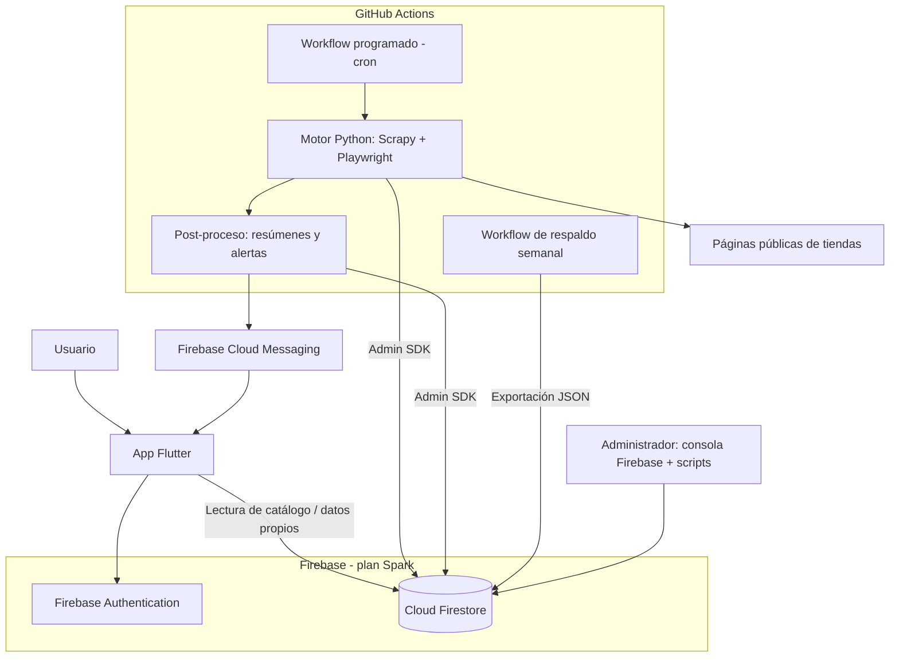
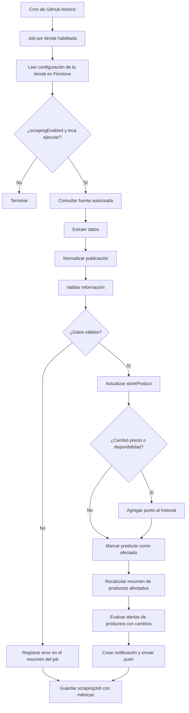
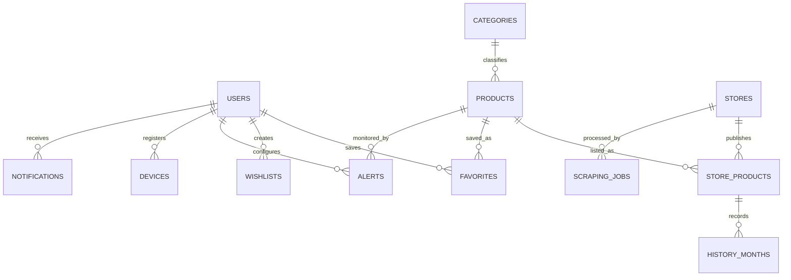

# CompraMejor

## Documentación funcional y técnica

| Campo | Valor |
|---|---|
| **Versión** | 1.1 |
| **Fecha** | 22 de noviembre de 2026 |
| **Mercado inicial** | Perú |
| **Plataformas** | Android (primero) e iOS (después) |
| **Tipo de solución** | Aplicación independiente de comparación de precios |
| **Estado** | Definición del producto — arquitectura de costo cero |

### Control de cambios

| Versión | Cambio |
|---|---|
| 1.0 | Definición inicial con Spring Boot, PostgreSQL, Redis y Celery. Copia en [docs/historial/PRECIO_JUSTO_v1.0_original.md](docs/historial/PRECIO_JUSTO_v1.0_original.md). |
| 1.1 | **Flutter** como tecnología móvil. **Sin backend propio.** Se adopta Firebase (plan gratuito Spark) y GitHub Actions para el scraping. Objetivo: desarrollar y validar el producto con **costo S/ 0**. Se corrigen vacíos del modelo de datos detectados en el análisis. |

---

## Índice

1. [Visión general del proyecto](#1-visión-general-del-proyecto)
2. [Alcance del producto](#2-alcance-del-producto)
3. [Requerimientos funcionales](#3-requerimientos-funcionales)
4. [Requerimientos no funcionales](#4-requerimientos-no-funcionales)
5. [Arquitectura tecnológica](#5-arquitectura-tecnológica)
6. [Arquitectura general](#6-arquitectura-general)
7. [Diseño del motor de scraping](#7-diseño-del-motor-de-scraping)
8. [Normalización e identificación de productos](#8-normalización-e-identificación-de-productos)
9. [Modelo de datos (Firestore)](#9-modelo-de-datos-firestore)
10. [Reglas de negocio](#10-reglas-de-negocio)
11. [Acceso a datos y reglas de seguridad](#11-acceso-a-datos-y-reglas-de-seguridad)
12. [Estructura del proyecto](#12-estructura-del-proyecto)
13. [Seguridad y protección de datos](#13-seguridad-y-protección-de-datos)
14. [Costos y límites del plan gratuito](#14-costos-y-límites-del-plan-gratuito)
15. [Modelo de negocio](#15-modelo-de-negocio)
16. [Plan de desarrollo](#16-plan-de-desarrollo)
17. [Primer sprint: fundación técnica](#17-primer-sprint-fundación-técnica)
18. [Indicadores del proyecto](#18-indicadores-del-proyecto)
19. [Riesgos y mitigaciones](#19-riesgos-y-mitigaciones)
20. [Decisiones técnicas que deben mantenerse](#20-decisiones-técnicas-que-deben-mantenerse)
21. [Visión de evolución](#21-visión-de-evolución)
- [Conclusión](#conclusión)

---

## 1. Visión general del proyecto

### 1.1. Descripción

CompraMejor es una aplicación móvil que permite a los consumidores buscar productos y comparar sus precios entre distintas tiendas virtuales del mercado peruano.

Su finalidad es ayudar a las personas a tomar mejores decisiones de compra mediante información organizada sobre precios, características, disponibilidad, evolución histórica y enlaces hacia las tiendas donde se comercializan los productos.

La aplicación contará con un motor de extracción automatizada de información mediante web scraping, encargado de consultar las páginas de comercio electrónico, obtener los datos disponibles y procesarlos para presentarlos de manera uniforme.

CompraMejor será un producto independiente, con sus propios usuarios, base de datos, infraestructura, identidad comercial y modelo de negocio.

### 1.2. Problema que busca resolver

Actualmente, una persona interesada en comprar un producto debe visitar distintas páginas comerciales para conocer sus precios. Esto genera dificultades:

- Inversión de tiempo al consultar diferentes tiendas.
- Dificultad para identificar el mismo producto entre distintas publicaciones.
- Desconocimiento de la evolución histórica de los precios.
- Dificultad para determinar si una oferta representa un ahorro real.
- Falta de alertas cuando un producto alcanza un precio conveniente.
- Información dispersa sobre disponibilidad y costos de envío.

### 1.3. Solución propuesta

Centralizar la información comercial disponible en distintas tiendas mediante una plataforma que permita:

1. Buscar productos.
2. Comparar ofertas.
3. Consultar el historial de precios.
4. Configurar alertas.
5. Guardar productos favoritos.
6. Consultar alternativas similares.
7. Acceder directamente a la tienda para realizar la compra.

### 1.4. Objetivos

**Objetivo general**

Desarrollar una plataforma tecnológica de comparación de precios que facilite la búsqueda de productos y permita identificar opciones de compra convenientes en el mercado peruano.

**Objetivos específicos**

- Implementar una aplicación móvil multiplataforma.
- Utilizar servicios administrados (Firebase) en lugar de un backend propio, para operar sin costo durante la validación.
- Desarrollar un motor de scraping independiente.
- Normalizar productos y ofertas provenientes de distintas tiendas.
- Mantener un historial de precios.
- Implementar alertas configurables.
- Diseñar una arquitectura que pueda crecer (plan de pago, nuevas tiendas y categorías) sin reescribirse.
- Desarrollar mecanismos de control de calidad y actualización de información.

### 1.5. Principios del producto

- Independencia de las tiendas comerciales.
- Transparencia en la presentación de precios.
- Información con fecha de última verificación.
- Identificación correcta de productos y variantes.
- Protección de la información personal.
- Arquitectura modular.
- Extracción responsable de información.
- No presentar precios antiguos como si fueran actuales.
- **Costo cero hasta validar el producto**: ninguna decisión técnica debe obligar a pagar antes de tener usuarios.

---

## 2. Alcance del producto

### 2.1. Mercado

El lanzamiento inicial estará dirigido al mercado peruano. La moneda principal será el sol peruano (PEN), aunque el diseño permitirá incorporar otras monedas posteriormente.

El sistema deberá contemplar:

- Precios con IGV cuando corresponda.
- Variaciones de precios por tienda.
- Disponibilidad de productos.
- Costos de envío cuando se encuentren disponibles.
- Ofertas y promociones.
- Diferencias entre vendedores y comercios dentro de marketplaces.

### 2.2. Categorías comerciales

La aplicación tendrá una estructura preparada para manejar múltiples categorías.

| Categoría | Subcategorías de ejemplo |
|---|---|
| Tecnología | Laptops, celulares, monitores, procesadores |
| Computación | SSD, RAM, placas madre, tarjetas gráficas |
| Electrodomésticos | Refrigeradoras, lavadoras, microondas |
| Hogar | Muebles, decoración, iluminación |
| Moda | Ropa, calzado, accesorios |
| Belleza | Cuidado personal, cosméticos |
| Deportes | Equipamiento, ropa deportiva |
| Juguetes | Juegos, juguetes educativos |
| Bebés | Accesorios, productos de cuidado |
| Automotriz | Accesorios, repuestos |
| Ferretería | Herramientas, materiales |
| Libros | Libros físicos y material educativo |

> **Alcance del MVP:** por los límites del plan gratuito (sección 14), el lanzamiento comenzará con **una categoría (Tecnología / Computación), 1 a 2 tiendas y unos cientos de productos**. Las demás categorías se incorporarán progresivamente según la viabilidad técnica, las condiciones de acceso a sus fuentes y la capacidad del plan.

### 2.3. Tipos de usuarios

| Tipo | Capacidades |
|---|---|
| **Visitante** | Buscar productos · Consultar comparaciones públicas · Visualizar ofertas |
| **Usuario registrado** | Guardar favoritos · Crear listas de seguimiento · Configurar alertas · Consultar historial de seguimiento · Administrar su perfil |
| **Administrador** | Administrar usuarios · Gestionar tiendas · Gestionar categorías · Supervisar procesos de scraping · Revisar errores · Moderar productos duplicados · Consultar métricas del sistema |
| **Operador de extracción** | Supervisar extractores · Revisar ejecuciones · Gestionar incidencias · Validar información extraída |

En el MVP, administrador y operador serán la misma persona y trabajarán con la consola de Firebase, GitHub Actions y scripts de administración (sección 7.8).

---

## 3. Requerimientos funcionales

### RF-01. Gestión de usuarios

El sistema permitirá (mediante Firebase Authentication):

- Registrar usuarios con correo y contraseña, y con cuenta de Google.
- Iniciar y cerrar sesión.
- Recuperar contraseñas.
- Actualizar información de perfil.
- Administrar dispositivos registrados para notificaciones.
- Configurar preferencias de notificación.
- Eliminar la cuenta y sus datos según las condiciones aplicables.

> No se usará inicio de sesión por SMS, porque tiene costo.

### RF-02. Búsqueda de productos

El usuario podrá buscar productos por:

- Nombre.
- Marca.
- Modelo.
- Código EAN/GTIN cuando esté disponible.
- Categoría.
- Palabras clave.

> **Ejemplo:** una búsqueda de "Kingston NV3 1TB" debe permitir encontrar el producto aunque la tienda lo publique con otro orden de palabras, sin mezclar productos con capacidades diferentes.

**Alcance en el MVP (implementado en el sprint 3):**

- Búsqueda por palabras normalizadas (minúsculas, sin tildes, unidades unificadas: `1000 GB` → `1tb`) guardadas en cada producto (`searchTokens`), **incluidos sus prefijos desde 3 letras**, para encontrar palabras incompletas ("kings nv3" → "Kingston NV3").
- Todas las palabras de la búsqueda deben estar en el producto, así que "kingston 2tb" no muestra el modelo de 1 TB (regla 8.3).
- Búsqueda por código de barras (8 a 14 dígitos) contra `identifierKeys`.
- La normalización existe en Python (al guardar) y en Dart (al buscar). Ambas se prueban con los mismos casos en `shared/test_vectors/search_normalization.json`.
- Firestore no ofrece búsqueda de texto completo ni tolerancia a errores ortográficos; esa capacidad se agregará en una fase posterior con un buscador externo (sección 21).

### RF-03. Catálogo de productos

Cada producto tendrá:

- Nombre normalizado.
- Marca.
- Modelo.
- Categoría.
- Descripción.
- Imagen de referencia (enlace).
- Identificadores comerciales.
- Características técnicas.
- Variantes.
- Estado de publicación.

Los productos deberán diferenciarse de las publicaciones de las tiendas:

- Un **producto** representa el artículo comercial normalizado.
- Una **publicación** representa cómo lo ofrece una tienda.

### RF-04. Comparación de precios

La aplicación presentará las ofertas encontradas para un producto. Información por oferta:

- Nombre de tienda.
- Precio actual detectado.
- Precio anterior, cuando exista y sea verificable.
- Disponibilidad.
- Costo de envío, si se conoce.
- Vendedor.
- Enlace de compra.
- Fecha y hora de última consulta.

El orden predeterminado será de menor a mayor precio, pero se podrán utilizar otros criterios.

> **Regla fundamental:** una oferta con información desactualizada deberá identificarse como tal y no presentarse como precio confirmado.

### RF-05. Historial de precios

El sistema conservará las observaciones históricas de cada oferta. Permitirá visualizar:

- Precio mínimo histórico observado.
- Precio máximo observado.
- Precio promedio del periodo.
- Evolución del precio.
- Fecha de cada observación.
- Variaciones porcentuales.

El historial representará observaciones recopiladas por CompraMejor, no necesariamente todos los precios que existieron en el mercado.

### RF-06. Alertas de precios

El usuario podrá configurar:

- Producto (y variante, si aplica) que desea seguir.
- Precio objetivo.
- Notificaciones habilitadas.
- Estado de la alerta.

Cuando una oferta cumpla la condición, el sistema generará una notificación. Se deberán evitar notificaciones repetidas por una misma condición sin una nueva variación relevante.

### RF-07. Favoritos y listas

El usuario podrá:

- Guardar productos.
- Crear listas personalizadas.
- Eliminar elementos.
- Consultar cambios de precios.
- Acceder a productos seguidos.

### RF-08. Recomendaciones y alternativas

El sistema podrá sugerir productos equivalentes o similares. La comparación deberá considerar:

- Marca.
- Modelo.
- Características.
- Capacidad.
- Dimensiones.
- Versión.
- Compatibilidad.

Las recomendaciones automatizadas deberán identificarse como sugerencias, no como equivalencias confirmadas. *(Fuera del MVP.)*

### RF-09. Administración de tiendas

El administrador podrá:

- Registrar tiendas.
- Editar información.
- Activar o desactivar fuentes.
- Configurar frecuencia de extracción y periodo de vigencia.
- Consultar estado del extractor.
- Revisar errores.
- Consultar historial de ejecuciones.

### RF-10. Administración del catálogo

El administrador podrá:

- Crear categorías.
- Modificar categorías.
- Registrar productos.
- Revisar duplicados.
- Relacionar publicaciones con productos.
- Corregir características.
- Desactivar registros incorrectos.

### RF-11. Motor de extracción

El sistema ejecutará procesos automatizados para:

1. Consultar las páginas permitidas.
2. Obtener información comercial.
3. Identificar publicaciones.
4. Extraer precios y disponibilidad.
5. Normalizar datos.
6. Validar resultados.
7. Guardar observaciones.
8. Registrar errores.
9. Actualizar el estado de las ofertas.
10. Recalcular el resumen de precios de cada producto afectado.
11. Evaluar alertas y enviar notificaciones.

### RF-12. Notificaciones

Se contemplan:

- Alertas de precio.
- Cambios relevantes de precio.
- Disponibilidad nuevamente detectada.
- Resumen de productos seguidos.

Canal del MVP: **notificaciones push** (gratis), sujetas a los permisos del usuario. El correo electrónico queda para una fase posterior.

---

## 4. Requerimientos no funcionales

| Código | Requerimiento | Cómo se cumple en v1.1 |
|---|---|---|
| RNF-01 | Aplicación compatible con Android e iOS | Flutter. Lanzamiento primero en Android. |
| RNF-02 | Acceso a datos documentado | Modelo de datos (sección 9) y reglas de seguridad versionadas (sección 11). |
| RNF-03 | Autenticación segura | Firebase Authentication. |
| RNF-04 | Contraseñas almacenadas mediante hash seguro | Gestionado por Firebase Authentication; la app nunca guarda contraseñas. |
| RNF-05 | Importes monetarios exactos | Montos en **céntimos como enteros** (Firestore no tiene DECIMAL). Nunca usar decimales flotantes para cálculos. |
| RNF-06 | Arquitectura modular | App, reglas y motor de scraping separados. |
| RNF-07 | Registro de operaciones importantes | Colección `auditLogs` y `scrapingJobs`; logs de GitHub Actions. |
| RNF-08 | Manejo de errores de extracción | Validadores y resumen de errores por ejecución. |
| RNF-09 | Protección contra consultas abusivas | Reglas de seguridad, consultas paginadas con límite, sin listados masivos desde la app. |
| RNF-10 | Respaldo periódico de información | Exportación semanal a JSONL con el workflow `backup.yml`. Con `BACKUP_PASSPHRASE` incluye usuarios y se cifra (AES-256); sin ella respalda solo el catálogo, porque los artefactos de un repositorio público son descargables (Ley 29733). |
| RNF-11 | Monitoreo de servicios | Historial de GitHub Actions, colección `scrapingJobs`, panel de uso de Firebase. |
| RNF-12 | Escalabilidad de trabajadores de scraping | Un job por tienda (matriz de GitHub Actions). |
| RNF-13 | Fecha de verificación visible | `lastCheckedAt` en cada oferta. |
| RNF-14 | Separación de información pública y privada | Catálogo público de solo lectura; datos de usuario solo accesibles por su dueño. |
| RNF-15 | Pruebas automatizadas | `flutter test` (app), pytest (scraping), pruebas de reglas con el emulador. |
| RNF-16 | **Operar dentro del plan gratuito** | Presupuesto de lecturas/escrituras (sección 14). |

### Objetivos iniciales de rendimiento

- Pantallas de lectura: la consulta principal de cada pantalla debe resolverse con **una o pocas lecturas** (datos agregados en el documento del producto).
- Paginación para catálogos y ofertas.
- Caché local del SDK de Firestore para evitar lecturas repetidas.
- Procesamiento asíncrono para extracción y notificaciones (fuera de la app).

No se garantizará una actualización inmediata de precios, porque depende de la frecuencia de consulta permitida, del comportamiento de cada tienda y de que los workflows programados de GitHub Actions pueden ejecutarse con retraso.

---

## 5. Arquitectura tecnológica

### 5.1. Stack seleccionado

| Capa | Tecnología | Costo |
|---|---|---|
| Aplicación móvil | Flutter + Dart | Gratis |
| Navegación | go_router | Gratis |
| Estado | Riverpod | Gratis |
| Autenticación | Firebase Authentication (correo y Google) | Gratis |
| Base de datos | Cloud Firestore (plan Spark) | Gratis dentro de cuota |
| SDK en la app | FlutterFire (`firebase_core`, `firebase_auth`, `cloud_firestore`) | Gratis |
| Notificaciones push | Firebase Cloud Messaging (`firebase_messaging`) | Gratis |
| Errores y métricas | Crashlytics + Google Analytics for Firebase | Gratis |
| Motor de scraping | Python + Scrapy | Gratis |
| Páginas dinámicas | Playwright (solo si es indispensable) | Gratis |
| Acceso del scraper a la BD | Firebase Admin SDK para Python | Gratis |
| Ejecución programada | GitHub Actions (cron) | Gratis dentro de cuota |
| Imágenes | Enlace a la imagen de la tienda (sin almacenamiento propio), solo de tiendas con permiso (`showImages`, ver 13.4) | Gratis |
| Entorno local | Firebase Emulator Suite | Gratis |
| Control de versiones | Git + GitHub | Gratis |
| CI | GitHub Actions | Gratis dentro de cuota |
| Pruebas | `flutter_test`, pytest, `@firebase/rules-unit-testing` (Node, solo para reglas) | Gratis |
| Builds móviles | Build local con Flutter (`flutter build appbundle`) | Gratis |

**Servicios excluidos por tener costo:** Cloud Functions, Cloud Storage, Data Connect / Cloud SQL, respaldos administrados de Firestore, autenticación por SMS.

### 5.2. Justificación

- **Flutter:** una sola base de código en Dart para Android e iOS, con buen rendimiento y soporte oficial de Firebase (FlutterFire). Los builds se generan localmente, sin servicios de pago.
- **Firebase Authentication:** registro, inicio de sesión, recuperación de contraseña y Google Sign-In sin servidor propio.
- **Cloud Firestore:** base de datos administrada con plan gratuito permanente, caché local y reglas de seguridad declarativas.
- **Python + Scrapy:** organiza la extracción en spiders, solicitudes, procesamiento de respuestas y pipelines.
- **GitHub Actions:** reemplaza al servidor de scraping y a la cola de trabajos (Redis + Celery): ejecuta el motor de forma programada y aislada, y guarda las credenciales como *secrets*.
- **Firebase Admin SDK:** permite al motor escribir en Firestore con privilegios de servidor (sin pasar por las reglas de la app).
- **Sin Cloud Functions:** la lógica que normalmente iría en un backend (resúmenes de precio, evaluación de alertas, envío de notificaciones) la ejecuta el motor de scraping al terminar cada corrida.

---

## 6. Arquitectura general

### 6.1. Estilo arquitectónico

Arquitectura **serverless de costo cero**, con tres piezas:

1. **Aplicación móvil**: lee el catálogo público y gestiona los datos propios del usuario directamente en Firestore, protegida por reglas de seguridad.
2. **Firebase** (Auth + Firestore): identidad y almacenamiento central.
3. **Motor de scraping en GitHub Actions**: extrae, normaliza, valida, guarda, recalcula resúmenes, evalúa alertas y envía notificaciones.

No existe un backend propio ni una API REST. La app **solo escribe** datos del usuario (perfil, favoritos, listas, alertas, dispositivos). El catálogo, las ofertas y el historial **solo los escribe** el motor de scraping o un administrador.

### 6.2. Diagrama de arquitectura



### 6.3. Flujo de extracción



### 6.4. Separación de responsabilidades

| Componente | Responsabilidad | No hace |
|---|---|---|
| **Aplicación móvil** | Mostrar catálogo, ofertas e historial; gestionar perfil, favoritos, listas, alertas y dispositivos del usuario. | No hace scraping. No escribe catálogo, ofertas ni historial. |
| **Firestore + reglas** | Fuente central de datos; las reglas definen quién lee y escribe cada colección. | No contiene lógica de negocio compleja. |
| **Motor de scraping** | Extracción, normalización, matching, historial, resúmenes, evaluación de alertas y envío de push. | No gestiona sesiones de usuario. |
| **Administrador** | Configurar tiendas y categorías, revisar coincidencias pendientes, asignar roles. | — |

---

## 7. Diseño del motor de scraping

### 7.1. Estrategia

Se desarrollará un extractor independiente por tienda. Cada tienda se ejecuta como un job separado en GitHub Actions (matriz), de modo que el fallo de una no afecta a las demás.

```text
scraping-engine/
├── app/
│   ├── spiders/
│   │   ├── store_a/
│   │   │   └── products.py
│   │   └── store_b/
│   │       └── products.py
│   ├── models/            # Contrato de datos (ScrapedOffer)
│   ├── normalizers/       # Títulos, unidades, marcas, searchTokens
│   ├── matching/          # Puntuación de coincidencia (sección 8)
│   ├── validators/
│   ├── pipelines/         # Escritura en Firestore
│   ├── postprocess/       # Resúmenes de producto y alertas
│   ├── notifications/     # Envío por FCM (Admin SDK)
│   ├── admin/             # Scripts de administración (CLI)
│   ├── backup/            # Exportación JSON
│   └── config/
├── tests/
│   └── fixtures/          # HTML local de ejemplo
├── requirements.txt
└── README.md
```

### 7.2. Contrato de datos

Todos los extractores deberán entregar una estructura común:

```json
{
  "store_code": "STORE_A",
  "external_product_id": "ABC-123",
  "title": "Kingston NV3 1TB",
  "brand": "Kingston",
  "model": "NV3",
  "price_cents": 24990,
  "currency": "PEN",
  "shipping_cents": null,
  "availability": "AVAILABLE",
  "condition": "NEW",
  "seller": "Tienda A",
  "identifiers": { "ean": null },
  "product_url": "https://example.com/product",
  "image_url": null,
  "checked_at": "2026-11-22T22:00:00Z"
}
```

> El dominio `example.com` es ilustrativo. No representa una tienda integrada ni una oferta real.
>
> El precio se convierte a céntimos **al parsear el texto** de la página (por ejemplo, `"S/ 249.90"` → `24990`) usando `Decimal`, nunca `float`. `shipping_cents: null` significa envío desconocido, no gratuito.

### 7.3. Componentes de un extractor

Cada extractor tendrá:

- Identificador de tienda.
- URL de origen.
- Configuración.
- Reglas de extracción.
- Selectores.
- Transformación de datos.
- Validación.
- Gestión de errores.
- Pruebas con HTML local guardado en `tests/fixtures/`.
- Registro de última ejecución.

### 7.4. Tipos de extracción

- **Extracción HTML:** para páginas cuyo contenido esté disponible en HTML y pueda consultarse de forma permitida. Es la opción preferida por ser la más rápida y la que menos minutos consume.
- **Extracción mediante estructuras públicas de la página:** datos estructurados (por ejemplo, JSON-LD de `schema.org/Product`) cuando estén expuestos y su uso esté permitido.
- **Extracción con navegador:** para páginas que requieran renderizado de JavaScript. Se utilizará Playwright únicamente cuando sea indispensable, porque consume más tiempo de GitHub Actions.

> No se utilizarán técnicas para eludir CAPTCHAs, autenticación, controles de acceso, bloqueos u otras medidas de seguridad.

### 7.5. Ejecución en GitHub Actions

| Aspecto | Definición |
|---|---|
| Disparador | `schedule` cada 6 horas (`15 */6 * * *` UTC) + `workflow_dispatch` (con opción de limitar páginas) |
| Frecuencia inicial | Cada 6 horas para Tecnología |
| Paralelismo | Matriz con un job por tienda, **una tienda a la vez** (`max-parallel: 1`) |
| Credenciales | Cuenta de servicio de Firebase guardada como secret `FIREBASE_SERVICE_ACCOUNT`. Si falta, el job avisa y termina sin ejecutar nada |
| Sincronización | Antes de cada corrida carga categorías y tiendas (idempotente) para que producción siempre coincida con el repositorio |
| Tiempo máximo | `timeout-minutes` por job para no consumir cuota ante bloqueos |
| Concurrencia | `concurrency` por tienda para no ejecutar dos corridas a la vez |
| Logs | Logs detallados en GitHub Actions; en Firestore solo el resumen del job |

**Cuota:** repositorio **privado** = 2.000 minutos/mes gratis; repositorio **público** = minutos ilimitados, pero el código del scraper queda visible (los secrets siguen protegidos). Estimación del MVP: 2 tiendas × 4 corridas/día × ~5 min ≈ **1.200 min/mes**, dentro de la cuota privada.

> En repositorios públicos, GitHub desactiva los workflows programados tras 60 días sin actividad en el repositorio. Verificar los límites vigentes de GitHub Actions antes de decidir la visibilidad del repositorio.

### 7.6. Frecuencia de actualización

| Tipo de producto | Frecuencia propuesta |
|---|---|
| Tecnología popular | 6 horas (MVP) — 2 a 6 horas cuando el plan lo permita |
| Electrodomésticos | 6 a 12 horas |
| Moda | 12 a 24 horas |
| Hogar | 12 a 24 horas |
| Productos de baja demanda | 24 a 48 horas |

Estos intervalos son configurables (`stores.scrapingIntervalMinutes`) y estarán subordinados a las condiciones de acceso, límites y políticas de cada fuente, y a la cuota del plan gratuito.

### 7.7. Reglas de extracción responsable

Antes de activar una tienda:

1. Revisar sus términos de uso.
2. Revisar sus políticas de automatización.
3. Consultar `robots.txt`.
4. Determinar qué páginas pueden consultarse.
5. Respetar límites de frecuencia (retardo entre solicitudes y `AUTOTHROTTLE` de Scrapy activado).
6. Identificar el cliente con un User-Agent propio del proyecto.
7. No acceder a información privada.
8. No recopilar datos personales innecesarios.
9. No evadir mecanismos de seguridad.
10. Registrar la evaluación en el documento de la tienda (`termsReviewedAt`, `robotsReviewedAt`, `reviewNotes`).
11. Desactivar el extractor cuando cambien las condiciones de acceso o se detecte un bloqueo.

> La presencia de información pública o de una instrucción en `robots.txt` no debe interpretarse por sí sola como una autorización legal ilimitada para cualquier uso.

#### Evaluación de tiendas (noviembre 2026)

El detalle de cada evaluación está en `scraping-engine/app/data/stores.json`.

| Tienda | Plataforma | Estado | Motivo |
|---|---|---|---|
| Coolbox | VTEX | ✅ Activa (6 h) | Términos sin prohibición; API pública de catálogo |
| Plaza Vea, Oechsle, Promart | VTEX | ✅ Activas (12 h) | Términos sin prohibición de extracción |
| Efe, La Curacao | Magento | ✅ Activas (12 h) | Términos sin prohibición; listado HTML con pausas de 6 s |
| SercoPlus | PrestaShop | ✅ Activa (12 h) | Responde sin desafío de Cloudflare; precio en soles publicado por la tienda junto al de dólares |
| Memory Kings | Sitio propio | ✅ Activa (12 h) | robots.txt solo bloquea su buscador; no publica términos (revisión legal antes del lanzamiento) |
| Impacto | Next.js | ⏸ Pendiente | Solo publica precios en dólares y su listado usa un buscador externo con una clave que no es nuestra |
| Metro | VTEX | ✅ Activa (12 h) | Términos sin prohibición de extracción; su política antifraude sobre bots se refiere a cuentas de usuario (el extractor no usa cuentas) |
| Ripley | Next.js | ⏸ Pendiente | Sus términos (Zendesk) responden 403 a lectores automáticos: hay que leerlos a mano antes de decidir |
| Carsa | VTEX | ❌ No viable | "el Usuario debe abstenerse de extraer y/o reutilizar partes del Contenido sin el consentimiento previo y expreso" |
| LG (tienda oficial) | Propia | ❌ No viable | "Ninguna de la información en este sitio puede ser copiada [...] para propósitos comerciales sin el consentimiento por escrito" |
| Samsung (tienda oficial) | Hybris | ❌ No viable | Prohíbe reproducir sus textos "excepto para su uso personal" |
| Max | — | ❌ Descartada | El dominio no responde |
| Estilos | VTEX | ✅ Activa (12 h) | Términos sin prohibición; laptops, celulares, monitores y electrohogar |
| Shopstar (Interbank) | VTEX | ✅ Activa (12 h) | Marketplace; su cláusula 9 prohíbe el "aprovechamiento indebido" en perjuicio del marketplace (amplia: revisión legal prioritaria). Solo electrohogar |
| Infotec | PrestaShop | ✅ Activa (12 h) | Términos solo de compras; número de parte del título como código (la "serie" del campo Modelo no se usa) |
| Phantom | Magento | ✅ Activa (12 h) | robots.txt pide `Crawl-delay: 10` (se respeta). Solo consolas (nueva categoría) |
| Inkafarma, Mifarma | — | ❌ No viable | "Quedan expresamente prohibidas la reproducción [...] o cualquier modo de utilización, de la totalidad o parte de los contenidos" |
| Tai Loy | Magento | ❌ No viable | El usuario se obliga a no "reproducir, duplicar, copiar [...] o explotar para fines comerciales, cualquier sección del WEBSITE" |
| Crisol | Magento | ❌ No viable | "debe abstenerse de extraer y/o reutilizar total o parcialmente dicho contenido" |
| Platanitos | — | ❌ Descartada | Responde 403 a nuestro bot (no se evade) |
| Juntoz | Next.js | ⏸ Pendiente | No publica un enlace a sus términos |
| Cyberplaza | OpenCart | ⏸ Pendiente | Sus páginas legales están vacías (plantilla sin contenido) |
| Tottus | — | ⏸ Baja prioridad | Supermercado con poca oferta en las categorías actuales |
| Wong | VTEX | ⏸ Pendiente | No se pudieron leer los términos |
| Falabella, Sodimac | — | ❌ No viable | Sus términos prohíben reproducir o explotar contenidos y "compilaciones de datos" sin consentimiento escrito |
| Hiraoka | — | ❌ No viable | Prohíbe expresamente la "extracción y/o reutilización" |

Para las tiendas no viables la alternativa es un programa de afiliados o un permiso escrito. Mercado Libre requiere su API oficial con una aplicación de desarrollador registrada.

### 7.8. Administración sin panel web (MVP)

Mientras no exista panel de administración, las tareas se harán con scripts en `scraping-engine/app/admin/`, ejecutados localmente o con `workflow_dispatch`:

| Script | Función |
|---|---|
| `categories.py` ✅ | Cargar o actualizar el árbol de categorías (`app/data/categories.json`) |
| `import_products.py` ✅ | Carga inicial de productos desde JSON; valida todo el archivo antes de escribir y no duplica |
| `seed.py` ✅ | Datos de ejemplo en el emulador (categorías, catálogo de muestra y ofertas ficticias) |
| `set_role.py` ✅ | Asignar o quitar rol `admin` u `operator` (custom claims de Firebase Auth); queda en auditLogs |
| `stores.py` ✅ | Registrar tiendas y su evaluación (`app/data/stores.json`). **Se niega a activar una tienda sin evaluación registrada** (7.7) |
| `review_matches.py` ✅ | `list`, `approve`, `assign`, `reject`, `create`: revisa asociaciones, recalcula precios y registra en auditLogs. `duplicates` y `merge`: unifica productos duplicados migrando favoritos, alertas y listas. `recheck [--dry-run]`: reaplica las reglas bloqueantes a las asociaciones automáticas |
| `status.py` ✅ | Estado de tiendas (al día / desactualizada / nunca corrió), pendientes y productos; resumen en cada ejecución de scraping |
| `app/backup/export.py` + `restore.py` ✅ | Respaldo JSONL comprimido (semanal en GitHub Actions) y restauración verificable en el emulador |

Los scripts escriben en el **emulador** por defecto. Para el proyecto real exigen `--prod --yes` y credenciales (`GOOGLE_APPLICATION_CREDENTIALS` con un archivo **fuera** del repositorio, o `FIREBASE_SERVICE_ACCOUNT`). Rechazan `--prod` si detectan el emulador.

La consola de Firebase sirve para consultas y correcciones puntuales. El panel web (Firebase Hosting, gratis) se construirá en una fase posterior.

---

## 8. Normalización e identificación de productos

Este será uno de los componentes más importantes del proyecto. Se implementa en Python dentro del motor (`app/matching/`).

### 8.1. Problema

Dos tiendas pueden publicar el mismo producto con nombres distintos. Ejemplo:

- Kingston SSD NV3 1TB.
- Disco sólido Kingston NV3 de 1000 GB.
- SSD Kingston 1TB PCIe 4.0 NV3.

El sistema deberá identificar si realmente corresponden al mismo producto.

### 8.2. Niveles de coincidencia

| Nivel | Tipo | Criterio |
|---|---|---|
| 1 | Identificación exacta | Coincidencia por EAN, GTIN u otro identificador confiable |
| 2 | Coincidencia por modelo | Marca, modelo, capacidad y características principales |
| 3 | Coincidencia por similitud | Comparación de nombres, atributos y características |
| 4 | Revisión manual | Cuando exista incertidumbre, la publicación quedará pendiente de validación |

### 8.3. Reglas de exclusión (bloqueantes)

No mezclar automáticamente, sin importar la puntuación:

- Productos de diferente capacidad.
- Diferentes generaciones.
- Versiones distintas.
- Colores cuando sean variantes relevantes.
- Productos nuevos y reacondicionados.
- Productos individuales y paquetes.
- Diferentes configuraciones técnicas.

Si alguna regla bloqueante se cumple, la publicación **no** se asocia y la puntuación no se calcula.

La IA podrá asistir en la normalización, pero no será la autoridad definitiva para fusionar productos.

### 8.4. Puntuación de coincidencia

Puntuación de 0 a 100:

| Criterio | Puntos |
|---|---|
| Marca | 20 |
| Modelo | 30 |
| Características | 30 |
| Capacidad o variante | 15 |
| Identificador coincidente (EAN/GTIN) | 5 |

> **Ajuste v1.1:** sin identificador, el máximo posible es 95. Por eso, una coincidencia exacta de identificador se trata como **Nivel 1** (asociación directa), y los umbrales para publicaciones sin identificador se definen así:

| Puntuación | Interpretación | `matchStatus` |
|---|---|---|
| Identificador coincidente y sin reglas bloqueantes | Asociación directa | `MATCHED_AUTO` |
| 90 a 100 | Coincidencia de alta confianza | `MATCHED_AUTO` |
| 75 a 89 | Coincidencia probable | `PENDING_REVIEW` |
| Menor a 75 | Sin coincidencia; puede crear producto nuevo en revisión | `UNMATCHED` |

Estos umbrales se ajustarán con datos reales y pruebas de falsos positivos.

### 8.5. Implementación (sprint 4)

Código en `scraping-engine/app/matching/` (`scoring.py` son funciones puras; `matcher.py` usa Firestore).

| Paso | Regla |
|---|---|
| 1 | Si la publicación ya tiene una decisión (`MATCHED_*`, `PENDING_REVIEW`, `REJECTED`), se respeta. Solo se procesan publicaciones nuevas o sin asociar |
| 2 | **Nivel 1:** mismo GTIN (código de barras) o mismo MPN (código del fabricante) → `MATCHED_AUTO` |
| 3 | **Niveles 2 y 3:** puntuación contra los productos de la misma categoría, descartando los bloqueados (8.3) |
| 4 | Sin coincidencia y con GTIN o MPN → se **crea el producto** a partir de la publicación (`products.source`) |
| 5 | Sin coincidencia ni identificadores → `UNMATCHED` (no aparece en la app hasta revisión) |

Ajustes descubiertos con datos reales de Coolbox:

- Los códigos de barras se guardan en forma canónica de 13 dígitos (`GTIN:`) y se valida el dígito verificador: UPC `740617338515` y EAN `0740617338515` son el mismo producto.
- Las versiones escritas juntas o separadas son equivalentes (`PCIE4.0` = `PCIe 4.0`).
- Palabras descriptivas ("disco", "unidad", "sólido"...) no cuentan como características.
- Las características se comparan contra el conjunto más pequeño: un título corto que **omite** datos no se castiga; uno que **contradice** datos, sí.
- La frecuencia (Hz) y la potencia (W) bloquean igual que la capacidad: 165 Hz y 180 Hz son modelos distintos.
- La tarjeta de video (RTX 3050 vs. RTX 4050) y la familia de procesador (Core i5 vs. i7, Ryzen 5 vs. 7) bloquean cuando ambos títulos las mencionan: la misma laptop con otra tarjeta es otro producto.
- Un código de fabricante es **una palabra** con letras y números (`BEE-S-KB5NA`, `CFI-2115`). Los nombres comerciales del campo "Modelo" ("PlayStation 5 Slim", "Switch 2") no son códigos: los comparten paquetes y variantes distintas, y usarlos unía productos diferentes. Tampoco los códigos internos de vendedores con fecha (10+ dígitos seguidos).
- En consolas, Pro / Slim / OLED / Lite y Digital / con lectora que se contradicen bloquean la unión (omitir "Slim" no bloquea).
- En consolas, un título con "+ juego/accesorio" es un paquete y no se une con la consola sola (el "+" de "50MP + 2MP" o "Black+Decker" no cuenta).
- Las publicaciones en revisión (`PENDING_REVIEW`) conservan el producto solo como sugerencia: **no** cuentan en el resumen de precios ni se muestran en la app hasta que se aprueban.
- `review_matches recheck` vuelve a aplicar las reglas a las asociaciones automáticas existentes (el motor respeta decisiones previas, así que una regla nueva no corrige sola lo ya asociado).

Resultado de la primera corrida real (Coolbox, 1 página por categoría): 251 publicaciones, **248 asociadas automáticamente (99 %)**, 3 en revisión manual (modelos realmente distintos), 0 falsos positivos detectados.

#### Asociación entre tiendas de distintas plataformas

Con seis tiendas (VTEX y Magento) aparecieron dos problemas nuevos y sus soluciones:

- **Código interno en vez de modelo.** En Plaza Vea, Oechsle y Promart el campo `productReference` es un correlativo interno ("20329474"); el modelo real está en la especificación "Modelo". `pick_mpn` usa `productReference` solo si parece un código de modelo (letras y números) y, si no, la especificación.
- **Códigos de modelo compartidos.** Un token con letras y dígitos de 5 o más caracteres (`LS51BPP`, `WT19BVTB`) que aparece en ambos títulos cuenta como coincidencia de modelo (+30), aunque el producto se haya creado con otro "modelo".
- **Enriquecimiento de identificadores.** Cuando una publicación se asocia, sus GTIN/MPN que el producto todavía no tiene se agregan a `identifierKeys` (una sola vez: marca `keysSynced`). Así la siguiente tienda que publique ese código coincide directamente en el nivel 1.
- **Posibles duplicados.** Si el código ya pertenece a **otro** producto no se fusiona nada automáticamente (RN-06): la publicación queda con `possibleDuplicateOf` y un operador decide con `review_matches duplicates` / `merge`.

**Unificación (`merge`).** Mueve las publicaciones al producto conservado, une identificadores y palabras de búsqueda, migra favoritos, alertas (que se reevalúan) y listas de los usuarios, y deja el producto eliminado con `status: MERGED` y `mergedInto`. La app redirige automáticamente al producto conservado si alguien abre un enlace antiguo.

**Tiendas sin códigos (SercoPlus, Memory Kings).** No publican código de fabricante ni de barras en sus listados: sus publicaciones solo se asocian por puntuación a productos que ya existen (creados por otras tiendas) y nunca crean productos. Memory Kings resume las capacidades como `16|512|16"`; el extractor las expande a `16GB 512GB 16"` para que el bloqueo por capacidad funcione. Primera prueba (Coolbox con 1 página por categoría): SSD Kingston NV3 2TB a S/ 1,121 en SercoPlus frente a S/ 1,299 en Coolbox; monitor MSI PRO MP251 a S/ 292 en Memory Kings frente a S/ 429. Las publicaciones sin pareja quedan `UNMATCHED` y aparecerán cuando otra tienda con códigos traiga ese producto.

Ejemplo en el emulador: la lavadora LG WT19BVTB cuesta S/ 1,549 en Efe y La Curacao frente a S/ 2,049 en Plaza Vea y Promart.

---

## 9. Modelo de datos (Firestore)

Firestore es una base de datos de documentos: no tiene joins ni DECIMAL. Por eso el modelo **desnormaliza** algunos datos (copias de nombre de tienda, resúmenes de precio en el producto) para que cada pantalla se resuelva con pocas lecturas.

### 9.1. Colecciones

| Ruta | Responsabilidad | Escribe |
|---|---|---|
| `users/{uid}` | Perfil, plan y preferencias | Usuario dueño |
| `users/{uid}/favorites/{productId}` | Favoritos | Usuario dueño |
| `users/{uid}/wishlists/{listId}` | Listas personalizadas | Usuario dueño |
| `users/{uid}/alerts/{alertId}` | Alertas de precio | Usuario dueño (el motor actualiza su estado) |
| `users/{uid}/devices/{deviceId}` | Tokens push | Usuario dueño |
| `users/{uid}/notifications/{id}` | Bandeja de notificaciones | Motor (el usuario solo marca como leída) |
| `stores/{storeCode}` | Tiendas y su configuración de extracción | Admin |
| `categories/{slug}` | Categorías | Admin |
| `products/{productId}` | Catálogo normalizado + resumen de precios | Motor / Admin |
| `storeProducts/{storeCode}__{externalId}` | Publicaciones (ofertas) | Motor / Admin |
| `storeProducts/{id}/history/{YYYY-MM}` | Historial mensual de precios | Motor |
| `scrapingJobs/{jobId}` | Resumen de cada ejecución | Motor |
| `auditLogs/{id}` | Auditoría de acciones administrativas | Motor / Admin |
| `config/app` | Parámetros globales | Admin |

**Equivalencias con el modelo relacional de v1.0:**

| Tabla v1.0 | En v1.1 |
|---|---|
| `users.password_hash` | Gestionado por Firebase Auth |
| `roles`, `user_roles` | Custom claims (`admin`, `operator`) |
| `product_identifiers`, `product_attributes`, `product_variants` | Campos dentro de `products` |
| `price_observations` | Puntos dentro de `storeProducts/{id}/history/{YYYY-MM}` |
| `scraping_logs` | Arreglo `errors` (máx. 50) en `scrapingJobs` + logs de GitHub Actions |
| `wishlist_items` | Arreglo `productIds` en cada lista |
| `UNIQUE(store_id, external_product_id)` | ID de documento determinista `{storeCode}__{externalId}` |
| `UNIQUE(user_id, product_id)` en favoritos | ID de documento = `productId` |

### 9.2. Relaciones



### 9.3. Definición de documentos

Convenciones: montos en **céntimos (entero)** con sufijo `Cents`; fechas como `Timestamp` de Firestore (UTC); `null` significa "desconocido".

#### `users/{uid}`

| Campo | Tipo | Notas |
|---|---|---|
| email | string | Copia de Firebase Auth |
| displayName | string | |
| plan | string | `FREE` \| `PREMIUM` (solo lo cambia un admin) |
| notificationPrefs | map | `{ push: bool, priceAlerts: bool, backInStock: bool, weeklySummary: bool }` |
| status | string | `ACTIVE` \| `DELETED` |
| createdAt | timestamp | |
| updatedAt | timestamp | |

#### `users/{uid}/favorites/{productId}`

| Campo | Tipo | Notas |
|---|---|---|
| productId | string | Igual al ID del documento |
| productName | string | Copia para mostrar sin leer el producto |
| imageUrl | string \| null | Copia |
| priceAtSaveCents | int \| null | Para mostrar "bajó desde que lo guardaste" |
| createdAt | timestamp | |

#### `users/{uid}/wishlists/{listId}`

| Campo | Tipo | Notas |
|---|---|---|
| name | string | Máx. 120 caracteres |
| productIds | array\<string\> | Sin duplicados (`arrayUnion`); máx. 100 |
| createdAt | timestamp | |
| updatedAt | timestamp | |

#### `users/{uid}/alerts/{alertId}`

| Campo | Tipo | Notas |
|---|---|---|
| productId | string | |
| variantId | string \| null | |
| productName | string | Copia |
| targetPriceCents | int | |
| currency | string | `PEN` |
| condition | string | `AT_OR_BELOW` (MVP) |
| status | string | `ACTIVE` \| `PAUSED` \| `TRIGGERED` |
| lastTriggeredAt | timestamp \| null | |
| lastTriggeredPriceCents | int \| null | Evita repetir la alerta con el mismo precio |
| createdAt | timestamp | |

#### `users/{uid}/devices/{deviceId}`

| Campo | Tipo | Notas |
|---|---|---|
| platform | string | `android` \| `ios` |
| pushToken | string | Token de FCM |
| status | string | `ACTIVE` \| `INVALID` |
| lastSeenAt | timestamp | |

#### `users/{uid}/notifications/{id}`

| Campo | Tipo | Notas |
|---|---|---|
| type | string | `PRICE_ALERT` \| `PRICE_DROP` \| `BACK_IN_STOCK` \| `SUMMARY` |
| title | string | |
| message | string | |
| payload | map | `{ productId, storeProductId, priceCents }` |
| readAt | timestamp \| null | Único campo editable por el usuario |
| createdAt | timestamp | |

#### `stores/{storeCode}`

| Campo | Tipo | Notas |
|---|---|---|
| name | string | |
| baseUrl | string | |
| countryCode | string | `PE` |
| status | string | `ACTIVE` \| `INACTIVE` \| `UNDER_REVIEW` |
| scrapingEnabled | bool | |
| scrapingIntervalMinutes | int | |
| freshnessMinutes | int | Periodo de vigencia (RN-01) |
| lastRunAt | timestamp \| null | |
| lastRunStatus | string \| null | |
| termsReviewedAt | timestamp \| null | |
| robotsReviewedAt | timestamp \| null | |
| reviewNotes | string | Resumen de la evaluación (7.7) |
| createdAt / updatedAt | timestamp | |

#### `categories/{slug}`

| Campo | Tipo | Notas |
|---|---|---|
| name | string | |
| parentSlug | string \| null | |
| description | string | |
| order | int | Orden de visualización |
| status | string | `ACTIVE` \| `INACTIVE` |

#### `products/{productId}`

| Campo | Tipo | Notas |
|---|---|---|
| categorySlug | string | |
| brand | string | |
| model | string | |
| normalizedName | string | |
| description | string | |
| imageUrl | string \| null | Enlace externo |
| condition | string | `NEW` \| `REFURBISHED` \| `USED` |
| status | string | `ACTIVE` \| `INACTIVE` \| `PENDING_REVIEW` |
| identifiers | map | `{ ean: [..], gtin: [..], mpn: [..] }` |
| identifierKeys | array\<string\> | `["EAN:0740617..."]` para buscar con `array-contains` |
| attributes | map | `{ capacity: "1tb", interface: "pcie 4.0" }` (valores normalizados) |
| variants | array\<map\> | `[{ id, name, attributes }]` |
| searchTokens | array\<string\> | Palabras normalizadas y sus prefijos (desde 3 letras) para la búsqueda |
| summary | map | Ver abajo |
| createdAt / updatedAt | timestamp | |

`summary` (lo recalcula el motor al terminar cada corrida):

```json
{
  "currency": "PEN",
  "minPriceCents": 24990,
  "minPriceStoreCode": "STORE_A",
  "maxPriceCents": 27900,
  "sortPriceCents": 24990,
  "offerCount": 3,
  "verifiedOfferCount": 2,
  "lastCheckedAt": "2026-11-22T22:00:00Z"
}
```

`minPriceCents` considera solo ofertas **vigentes, disponibles y en la misma moneda** (RN-01, RN-02, RN-04).

`sortPriceCents` es igual a `minPriceCents`, o `9999999999` si no hay precio verificado. Se usa para ordenar el catálogo en Firestore con los productos sin precio al final (Firestore pone los `null` primero y excluye los documentos sin el campo).

#### `storeProducts/{storeCode}__{externalId}`

| Campo | Tipo | Notas |
|---|---|---|
| storeCode | string | |
| storeName | string | Copia |
| externalProductId | string | |
| productId | string \| null | `null` hasta validar la coincidencia |
| variantId | string \| null | |
| title | string | Título original de la tienda |
| productUrl | string | |
| imageUrl | string \| null | |
| sellerName | string \| null | |
| condition | string | |
| matchStatus | string | `MATCHED_AUTO` \| `MATCHED_MANUAL` \| `PENDING_REVIEW` \| `UNMATCHED` \| `REJECTED` |
| matchScore | int \| null | 0–100 |
| currentPriceCents | int | |
| previousPriceCents | int \| null | Solo si fue observado por CompraMejor |
| currentShippingCents | int \| null | `null` = desconocido |
| listPriceCents | int \| null | Precio "normal" que publica la tienda (tachado). **No** es un precio anterior observado (RF-04): no se muestra como "antes" |
| identifiers | map | `{ GTIN: canónico, MPN: código del fabricante }` |
| categoryHint | string \| null | Nuestra categoría según la categoría de la tienda |
| matchReason | string | Motivo de la asociación ("mismo código de barras", "puntuación alta"...) |
| currency | string | |
| availability | string | RN-05 |
| lastCheckedAt | timestamp | |
| lastChangedAt | timestamp | Último cambio de precio o disponibilidad |
| status | string | `ACTIVE` \| `GONE` (ya no aparece en la tienda) |
| createdAt / updatedAt | timestamp | |

#### `storeProducts/{id}/history/{YYYY-MM}`

Un documento por mes con un arreglo de puntos. Leer un mes de historial cuesta **una sola lectura**.

| Campo | Tipo | Notas |
|---|---|---|
| month | string | `2026-11` |
| points | array\<map\> | `[{ t: timestamp, p: priceCents, a: availability, s: shippingCents \| null }]` |
| lastCheckedAt | timestamp | Fecha del último punto agregado (la verificación sin cambios se registra en `storeProducts.lastCheckedAt`) |

Se agrega un punto **solo cuando cambia el precio, la disponibilidad o el envío** (RN-07). La continuidad de verificación queda registrada en `lastCheckedAt`.

#### `scrapingJobs/{jobId}`

| Campo | Tipo | Notas |
|---|---|---|
| storeCode | string | |
| jobType | string | `SCHEDULED` \| `MANUAL` |
| status | string | `RUNNING` \| `SUCCESS` \| `PARTIAL` \| `FAILED` |
| startedAt / finishedAt | timestamp | |
| productsFound | int | |
| productsValidated | int | |
| productsFailed | int | |
| pricesChanged | int | |
| alertsTriggered | int | |
| errors | array\<map\> | Máx. 50: `{ severity, message, url }` |
| runUrl | string | Enlace a la ejecución en GitHub Actions |

#### `auditLogs/{id}`

| Campo | Tipo | Notas |
|---|---|---|
| actorUid | string \| null | `null` si fue el motor |
| action | string | |
| entityType | string | |
| entityId | string | |
| details | map | |
| createdAt | timestamp | |

#### `config/app`

| Campo | Tipo | Notas |
|---|---|---|
| defaultFreshnessMinutes | int | Vigencia por defecto |
| freePlanLimits | map | `{ favorites: 50, alerts: 5, wishlists: 3 }` |
| minAppVersion | string | Para forzar actualización |

### 9.4. Índices

Firestore indexa cada campo automáticamente. Índices compuestos necesarios (en `firestore.indexes.json`):

| Colección | Campos | Uso |
|---|---|---|
| `storeProducts` | `productId` ASC, `currentPriceCents` ASC | Ofertas de un producto ordenadas por precio |
| `storeProducts` | `matchStatus` ASC, `createdAt` DESC | Cola de revisión manual |
| `products` | `categorySlug` ASC, `status` ASC, `summary.minPriceCents` ASC | Productos por categoría ordenados por precio |
| `products` | `searchTokens` CONTAINS, `status` ASC | Búsqueda |
| `alerts` (grupo de colecciones) | `productId` ASC, `status` ASC | El motor busca alertas activas de un producto |

### 9.5. Reglas de almacenamiento

- Dinero en **céntimos como enteros**; nunca `float` ni `double` para montos.
- Conservar la moneda original de cada observación.
- Fechas en UTC (`Timestamp`); convertir a hora de Lima al mostrar.
- No sobrescribir el historial de precios; solo agregar puntos.
- Mantener la publicación separada del producto normalizado.
- Evitar duplicados con IDs de documento deterministas.
- Borrado lógico (`status`) para registros comerciales.
- Retención: conservar el historial completo mientras el almacenamiento total esté por debajo de ~700 MB; después, compactar meses antiguos (un punto por día).

---

## 10. Reglas de negocio

| Código | Regla | Descripción |
|---|---|---|
| RN-01 | Precio vigente | Una oferta se muestra como verificada solo si `ahora − lastCheckedAt ≤ freshnessMinutes` de su tienda. Lo calcula la app al mostrar. |
| RN-02 | Precio más bajo | Se calcula considerando solo ofertas comparables (mismo producto y variante, misma condición), vigentes y disponibles. |
| RN-03 | Costo total | Cuando se conoce el envío: **costo total = precio + envío**. Un envío desconocido (`null`) no se suma como cero; se muestra "envío no informado". |
| RN-04 | Moneda | Las comparaciones directas usan la misma moneda. Si se incorpora conversión, se mostrará el tipo de cambio y su fecha. |
| RN-05 | Disponibilidad | Valores permitidos: `AVAILABLE`, `OUT_OF_STOCK`, `PREORDER`, `UNKNOWN`. |
| RN-06 | Productos duplicados | No se asocian publicaciones automáticamente si la coincidencia no alcanza el umbral o si aplica una regla bloqueante (sección 8). |
| RN-07 | Historial | Se agrega un punto de historial cuando cambia precio, disponibilidad o envío. Cada verificación sin cambios actualiza `lastCheckedAt`. |
| RN-08 | Alertas | Una alerta se activa solo con una oferta vigente y disponible cuyo precio cumpla la condición. No se repite si el precio es igual o mayor a `lastTriggeredPriceCents`; vuelve a dispararse si baja más o si el precio sube por encima del objetivo y luego vuelve a cumplirlo. **Implementación:** la alerta sigue `ACTIVE` después de avisar (si pasara a `TRIGGERED` el motor dejaría de vigilarla); el motor evalúa al cerrar cada corrida las alertas de los productos que cambiaron y las nunca evaluadas (`evaluatedAt == null`), y nunca avisa con un precio vencido. |
| RN-09 | Información desactualizada | Las ofertas fuera del periodo de vigencia se muestran como "desactualizadas" y no cuentan para el precio más bajo. Si una publicación no aparece en 3 corridas seguidas, pasa a `status: GONE`. |
| RN-10 | Publicaciones comerciales | El enlace dirige a la publicación de la tienda. CompraMejor no procesa pagos ni es responsable de la transacción en su primera versión. |
| RN-11 | Límites del plan gratuito de usuario | Favoritos, alertas y listas se limitan según `config/app.freePlanLimits` (por defecto 50, 5 y 3; 100 productos por lista). En el MVP el límite se valida en la app con un conteo agregado (1 lectura); el motor ignora alertas que excedan el límite. Premium no tiene el límite gratuito. |

---

## 11. Acceso a datos y reglas de seguridad

No hay API REST propia. La app usa **FlutterFire** y el motor usa el **Admin SDK de Python**.

### 11.1. Consultas de la app

| Pantalla / función | Consulta | Lecturas aprox. |
|---|---|---|
| Inicio / categoría | `products` where `categorySlug in [X y subcategorías]` and `status == ACTIVE` orderBy `summary.sortPriceCents` limit 21 (el extra indica si hay otra página); siguientes páginas con `startAfterDocument` | 21 por página |
| Búsqueda | `products` where `searchTokens array-contains <palabra más larga>` and `status == ACTIVE` limit 40 (el resto de palabras se filtra en la app); espera 350 ms tras la última tecla | ≤ 40 |
| Búsqueda por código | `products` where `identifierKeys array-contains-any [EAN:x, GTIN:x, UPC:x]` limit 10 | ≤ 10 |
| Detalle de producto | `products/{id}` | 1 |
| Comparar ofertas | `storeProducts` where `productId == X` orderBy `currentPriceCents` | N.° de tiendas |
| Historial | `storeProducts/{id}/history/{YYYY-MM}` de los últimos 3 meses | 3 por oferta |
| Favoritos | `users/{uid}/favorites` | N.° de favoritos |
| Alertas | `users/{uid}/alerts` | N.° de alertas |
| Notificaciones | `users/{uid}/notifications` orderBy `createdAt` desc limit 20 | ≤ 20 |

### 11.2. Reglas de seguridad (resumen)

```text
rules_version = '2';
service cloud.firestore {
  match /databases/{db}/documents {

    function signedIn() { return request.auth != null; }
    function isOwner(uid) { return signedIn() && request.auth.uid == uid; }
    function isAdmin() { return signedIn() && request.auth.token.admin == true; }

    // Catálogo público: lectura para todos, escritura solo admin
    // (el motor usa Admin SDK y no pasa por estas reglas)
    match /categories/{id}    { allow read: if true; allow write: if isAdmin(); }
    match /products/{id}      { allow read: if true; allow write: if isAdmin(); }
    match /stores/{id}        { allow read: if true; allow write: if isAdmin(); }
    match /storeProducts/{id} {
      allow read: if true; allow write: if isAdmin();
      match /history/{month}  { allow read: if true; allow write: if isAdmin(); }
    }

    // Datos de usuario: solo el dueño
    match /users/{uid} {
      allow read: if isOwner(uid);
      // El plan solo lo cambia un admin (o el motor con Admin SDK)
      allow create: if isOwner(uid) && request.resource.data.plan == 'FREE';
      allow update: if isOwner(uid)
        && !request.resource.data.diff(resource.data).affectedKeys().hasAny(['plan']);
      allow delete: if isOwner(uid);

      match /favorites/{pid}  { allow read, write: if isOwner(uid); }
      match /wishlists/{lid}  { allow read, write: if isOwner(uid); }
      match /alerts/{aid}     { allow read, write: if isOwner(uid); }
      match /devices/{did}    { allow read, write: if isOwner(uid); }
      match /notifications/{nid} {
        allow read, delete: if isOwner(uid);
        allow update: if isOwner(uid)
          && request.resource.data.diff(resource.data).affectedKeys().hasOnly(['readAt']);
      }
    }

    // Operación interna: solo admin
    match /scrapingJobs/{id} { allow read: if isAdmin(); allow write: if false; }
    match /auditLogs/{id}    { allow read: if isAdmin(); allow write: if false; }
    match /config/{id}       { allow read: if true; allow write: if isAdmin(); }
  }
}
```

Las reglas definitivas incluirán validación de tipos y tamaños (por ejemplo, `targetPriceCents` entero positivo, `name` ≤ 120 caracteres) y se probarán con el emulador.

### 11.3. Escrituras del motor (Admin SDK)

| Operación | Colección |
|---|---|
| Crear/actualizar publicaciones | `storeProducts` |
| Agregar punto de historial | `storeProducts/{id}/history/{YYYY-MM}` |
| Recalcular resumen | `products/{id}.summary` |
| Evaluar alertas (consulta de grupo `alerts` por `productId`) | `users/{uid}/alerts/{id}` |
| Crear notificación | `users/{uid}/notifications` |
| Marcar token inválido | `users/{uid}/devices/{id}` |
| Registrar ejecución | `scrapingJobs`, `stores/{code}.lastRunAt` |

Las escrituras se agrupan en lotes (`batch`, máx. 500 operaciones) para reducir tiempo de ejecución.

---

## 12. Estructura del proyecto

Un solo repositorio:

```text
precio-justo/
│
├── mobile_app/                 # Flutter + Dart
│   ├── lib/
│   │   ├── main.dart
│   │   ├── firebase_options.dart   # Generado por FlutterFire CLI
│   │   ├── app/                # Router, tema, configuración
│   │   ├── core/               # Formato de moneda (céntimos → "S/ 249.90"), fechas
│   │   ├── models/             # Product, StoreProduct, Category...
│   │   ├── services/           # firebase_bootstrap.dart, repositorios Firestore
│   │   └── features/           # catalog, offers, history, favorites, alerts, auth
│   ├── test/
│   ├── android/
│   ├── ios/
│   └── pubspec.yaml
│
├── scraping-engine/            # Python (ver 7.1)
│
├── firestore.rules
├── firestore.indexes.json
├── firebase.json               # Configuración de emuladores y despliegue de reglas
├── .firebaserc
│
├── .github/workflows/
│   ├── ci.yml                  # Pruebas de app, motor y reglas
│   ├── scrape.yml              # Scraping programado (matriz por tienda)
│   └── backup.yml              # Exportación semanal a JSON
│
├── docs/
│   ├── historial/
│   └── decisiones/
│
├── .env.example                # Variables públicas de configuración de Firebase
└── README.md
```

> La configuración web de Firebase (`apiKey`, `projectId`, etc.) **no es secreta**; la protección la dan las reglas de seguridad. Lo que **sí es secreto** es la cuenta de servicio del Admin SDK: nunca se sube al repositorio, solo se guarda como secret de GitHub.

---

## 13. Seguridad y protección de datos

### 13.1. Seguridad de aplicación

- Autenticación con Firebase Authentication (correo y Google).
- Tokens de sesión, renovación y revocación gestionados por Firebase.
- Roles mediante custom claims (`admin`, `operator`).
- Reglas de seguridad de Firestore con pruebas automatizadas.
- Validación de entradas en la app y en las reglas.
- Consultas siempre con `limit`.
- Cuenta de servicio solo en GitHub Secrets, con rotación periódica.
- HTTPS en todas las comunicaciones (por defecto en Firebase).
- Auditoría de acciones administrativas en `auditLogs`.
- **Fase posterior:** Firebase App Check (`firebase_app_check`) para limitar el acceso a la app oficial.

### 13.2. Protección de usuarios

El sistema recopilará únicamente los datos personales necesarios para prestar el servicio (correo, nombre visible, preferencias y tokens push). Se deberán establecer:

- Política de privacidad (obligatoria para publicar en Google Play).
- Condiciones de uso.
- Consentimiento cuando corresponda.
- Procedimientos de atención de derechos de los titulares (acceso, rectificación, cancelación, oposición).
- Eliminación de cuenta desde la app, que borra `users/{uid}` y sus subcolecciones.
- Políticas de retención y eliminación.
- Gestión de incidentes.

En Perú se debe considerar la **Ley N.° 29733** y su Reglamento aprobado por el **Decreto Supremo N.° 016-2024-JUS**. Al usar Firebase, los datos se alojan fuera del Perú, lo que constituye **flujo transfronterizo** de datos personales y debe informarse en la política de privacidad.

### 13.3. Seguridad del scraping

- No guardar credenciales de clientes de tiendas.
- No acceder a áreas privadas.
- No eludir mecanismos de protección.
- No utilizar información personal de compradores.
- Limitar frecuencia de solicitudes.
- Mantener trazabilidad de las fuentes.
- Detener extractores ante cambios de restricciones o condiciones de acceso.

La viabilidad jurídica y contractual deberá evaluarse individualmente para cada tienda antes de su incorporación comercial.

---

### 13.4. Fotos de productos (revisión preliminar del 24-11-2026)

No es asesoría legal: debe confirmarla un abogado antes del lanzamiento comercial.

- **Términos de las tiendas activas:** ninguno prohíbe expresamente usar sus fotos. Nueve no tienen
  cláusulas de propiedad intelectual; Coolbox llama a sus fotos «referenciales»; Memory Kings no
  publica términos; Shopstar (sección 9) prohíbe en términos amplios el «aprovechamiento indebido»
  de la plataforma (el caso de mayor riesgo). Que no se prohíba no equivale a tener permiso.
- **Ley (D. Leg. 822, derecho de autor):** las fotografías están protegidas aunque sean de producto;
  su titular es la tienda o, a menudo, la marca. Perú tiene una lista cerrada de excepciones, sin un
  «uso justo» amplio, y un comparador de precios no encaja claramente en ninguna. Enlazar la foto
  sin copiarla reduce el riesgo, pero no lo elimina. Además, consume ancho de banda de la tienda.
- **Decisión:** las fotos de una tienda solo se muestran con `showImages: true` en `stores.json`,
  que se activa únicamente con permiso escrito o licencia (por ejemplo, un programa de afiliados).
  Por defecto está desactivado en todas. El motor sigue guardando el enlace en `storeProducts`
  (no se muestra), así que activar una tienda no requiere volver a extraer nada.
- **Estado actual (24-11-2026):** por decisión del responsable del proyecto, `showImages` está
  activado en las 11 tiendas activas mientras la app es pequeña, **asumiendo el riesgo descrito**.
  Pendiente antes del lanzamiento comercial o al crecer: afiliarse a las tiendas o pedir permiso, y
  apagar `showImages` en las que no lo den (la app vuelve sola al ícono de categoría).
- **Cómo se aplica:** el resumen de cada producto solo toma fotos de tiendas permitidas
  (`imageStoreCode`). `python -m app.admin.images`, que el workflow corre en cada ejecución, retira
  las fotos no permitidas que ya estaban guardadas. La app muestra el ícono de la categoría.

## 14. Costos y límites del plan gratuito

### 14.1. Costo por etapa

| Etapa | Costo |
|---|---|
| Desarrollo y pruebas | **S/ 0** |
| Publicación en Google Play | US$ 25 (pago único) |
| Publicación en App Store | US$ 99 por año (posponer; lanzar primero en Android) |
| Crecimiento (si se supera la cuota) | Pasar a plan Blaze: se mantiene la misma cuota gratuita y solo se paga el exceso |

### 14.2. Cuotas gratuitas relevantes

| Servicio | Cuota gratuita |
|---|---|
| Firestore — almacenamiento | 1 GiB |
| Firestore — lecturas | 50.000 por día |
| Firestore — escrituras | 20.000 por día |
| Firestore — eliminaciones | 20.000 por día |
| Firestore — transferencia de salida | 10 GiB por mes |
| Firebase Auth (correo y Google) | Sin costo en uso normal |
| Firebase Cloud Messaging | Sin costo |
| GitHub Actions (repo privado) | 2.000 minutos por mes |

> Las cuotas pueden cambiar. Verificar los valores vigentes en la página de precios de Firebase y de GitHub antes de cada etapa. En Spark, al agotar la cuota diaria el servicio se detiene hasta el día siguiente (no genera cobros).

### 14.3. Optimizaciones aplicadas en el sprint 5

| Medida | Efecto |
|---|---|
| Una publicación sin cambios **no se reescribe**; la verificación queda en `stores.lastCompleteRunAt` (1 escritura por corrida) | Las escrituras pasan de ~N por corrida a solo los cambios |
| Las publicaciones de la tienda se leen en **una consulta** al inicio; la detección de retiradas las reutiliza | Sin lecturas extra; la corrida es mucho más rápida |
| Escrituras en lotes de 400 | Menos viajes de red |
| El corrector de nombres solo actúa si el título cambió (1 lectura) | Evita leer categorías completas |
| Frecuencia: Coolbox cada 12 h y las demás tiendas cada 24 h (vigencia 24 h y 36 h). Alcance: los primeros 200 productos por categoría en VTEX y 6 páginas en tiendas HTML | Lecturas diarias dentro del plan gratuito con 13 tiendas |

La app y el motor usan la misma regla: una oferta con `missedRuns == 0` está verificada en `max(lastCheckedAt, stores.lastCompleteRunAt)`.

#### Presupuesto diario (incidente del 23-11-2026)

La primera carga completa de Plaza Vea guardó 7 200 publicaciones (≈ 4 escrituras cada una) y agotó
las 20 000 escrituras diarias del plan Spark: el resto de tiendas falló con `429 Quota exceeded`.
Mientras la cuota está agotada, **la app tampoco puede leer ni escribir** hasta la medianoche del
Pacífico (03:00 en Lima). Medidas:

| Medida | Detalle |
|---|---|
| Presupuesto del motor | `app/quota.py`: el motor usa como máximo 38 000 lecturas y 15 000 escrituras por día (el resto queda para la app) y cada tienda como máximo 9 000 / 3 500 por corrida. El consumo se acumula en `system/quota-AAAA-MM-DD` (día del Pacífico) |
| Detención ordenada | Al llegar al tope, o si Firestore responde 429, la tienda se detiene: lo procesado queda guardado, la corrida es `QUOTA_LIMITED` (parcial: no marca desaparecidos ni `lastCompleteRunAt`) y la siguiente continúa |
| Sin presupuesto, no corre | Antes de leer las publicaciones de una tienda se cuentan (1 lectura por cada 1 000); si no caben, no se hace ninguna solicitud a la tienda |
| Alcance por categoría | `maxPagesPerCategory` en `stores.json` (por defecto 4 páginas VTEX de 50 = 200 productos; 6 páginas en tiendas HTML). Las corridas con este alcance siguen siendo completas |
| Reintentos espaciados | Una publicación sin pareja se vuelve a intentar cada 3 días (o antes si cambian su título o sus códigos) |
| Producto nuevo en 2 escrituras | La publicación y el producto (ya con su resumen) se guardan juntos; el historial empieza con el primer cambio de precio, guardando también el precio inicial. La app usa `lastChangedAt` como primer punto mientras no haya historial |
| Cupo agotado al iniciar | Si Firestore responde 429 antes de empezar, la tienda se salta sin fallar y continúa en la próxima corrida |
| Limpieza barata | Una publicación que desaparece y nunca aportó precio (sin asociar o en revisión) se **borra** (los borrados tienen su propia cuota) en vez de gastar 3 escrituras |

La primera carga de las 13 tiendas toma unos 2 días: cada corrida avanza hasta su tope y la siguiente continúa.

### 14.3.1. Catálogo local en el celular (24-11-2026)

Con Firestore, cada visita a la app costaba unas 100 a 150 lecturas (inicio, categorías, tiendas,
producto, ofertas). Con la reserva que deja el motor alcanzaba para unas 100 visitas al día, y el
24-11 el cupo se agotó con muy pocos usuarios.

- **Publicación:** al terminar cada corrida, el job «Publicar catálogo de la app» ejecuta
  `python -m app.export.catalog`, que genera `catalog.json` (productos activos, ofertas
  confirmadas, tiendas y categorías) y lo publica en GitHub Pages:
  `https://pashko577.github.io/PrecioJustoApp/catalog.json`. GitHub Pages lo sirve comprimido.
- **Exportación incremental:** parte del catálogo publicado y solo lee de Firestore los documentos
  con `updatedAt` posterior (con 30 min de margen). Normalmente son cientos de lecturas por día.
  Los domingos (corrida de las 12:15 UTC), o a pedido con `catalogo_completo`, se rearma completo.
  Antes de leer estima el costo (contar cuesta 1 lectura por cada 1000) y, si pasaría las 47 000
  lecturas del día, mantiene la versión publicada.
- **App:** `CatalogCache` guarda el archivo en el celular, lo usa al abrir (instantáneo y sin
  internet) y pide uno nuevo cada 2 horas o al deslizar para actualizar (`If-None-Match`: 304
  si no cambió). Navegar, buscar, comparar y ver bajadas no lee Firestore. La búsqueda local usa
  la misma normalización que la de Firestore.
- **Sigue en Firestore:** la cuenta y sus datos (favoritos, listas, alertas, notificaciones), el
  historial de precios (solo al abrir el gráfico) y un producto creado después de la última
  publicación. Si el catálogo no se puede descargar ni hay copia guardada, la app vuelve a
  consultar Firestore como antes.
- **Requisito:** GitHub Pages activado en el repositorio con fuente «GitHub Actions».

### 14.3.2. Copia de trabajo del motor (25-11-2026)

El motor gastaba unas 30 000 lecturas diarias. Cada tienda leía al empezar todas sus
publicaciones (Plaza Vea: 7 200) y todos los productos de sus categorías para buscar coincidencias,
aunque la tienda anterior los hubiera leído minutos antes.

- **Copia (`app/state.py`):** el job «Publicar catálogo» arma `engine-state.json.gz` (productos y
  publicaciones, sin `searchTokens` ni `titleTokens`) y la guarda en la caché de GitHub Actions
  (`engine-state-<run_id>`; cada job restaura la más reciente).
- **Cada tienda:** carga la copia y solo pide a Firestore lo cambiado desde entonces: sus
  publicaciones con `updatedAt` posterior (índice `storeCode + updatedAt`) y los productos
  cambiados. La búsqueda de coincidencias usa la copia en memoria (`ProductMatcher.preload`).
  Al terminar deja sus publicaciones finales (`state-out/{TIENDA}.json.gz`, artefacto de 1 día).
- **Job final:** toma las publicaciones finales de las tiendas que corrieron (exactas, incluidos
  los borrados), lee los productos cambiados y lo cambiado de las demás tiendas, guarda la copia
  nueva y arma `catalog.json` desde ella, sin más lecturas.
- **Respaldo:** sin copia, con una copia de más de 3 días, dañada o sin el índice, el motor lee
  Firestore como antes. La copia se rearma completa los domingos (o con `catalogo_completo`) si
  hay cupo.
- **Sigue igual:** las escrituras (Firestore es la fuente oficial), la búsqueda de productos por
  código cuando el código no está en la copia (detecta productos creados por otra tienda), y el
  recálculo de resúmenes.
- **Efecto esperado:** de ~30 000 a unas 2 000 a 5 000 lecturas al día.

### 14.4. Presupuesto diario estimado del MVP

Supuestos: 2 tiendas, 500 publicaciones, 4 corridas por día, 100 usuarios activos.

| Origen | Escrituras/día | Lecturas/día |
|---|---|---|
| Motor: actualizar publicaciones (500 × 4) | 2.000 | 2.000 |
| Motor: historial (≈10 % con cambios) | 200 | 200 |
| Motor: resúmenes de productos afectados | 200 | 1.000 |
| Motor: alertas y notificaciones | 100 | 500 |
| App: 100 usuarios × ~150 lecturas | — | 15.000 |
| App: favoritos, alertas, perfil | 300 | — |
| **Total** | **≈ 2.800 (14 % de la cuota)** | **≈ 18.700 (37 % de la cuota)** |

Prácticas obligatorias para mantenerse en cuota:

- Leer el resumen del producto en lugar de todas sus ofertas en los listados.
- Paginación con `limit` en todas las listas.
- Aprovechar la caché local del SDK.
- Agregar historial solo con cambios.
- No usar listeners en tiempo real (`snapshots()`) en listados; solo lecturas puntuales (`get()`).
- Revisar el panel de uso de Firebase semanalmente.

---

## 15. Modelo de negocio

### 15.1. Freemium

| Versión gratuita | Versión Premium |
|---|---|
| Búsquedas | Mayor cantidad de alertas |
| Comparación de ofertas | Seguimiento ampliado |
| Historial básico | Historial avanzado |
| Favoritos limitados | Comparaciones personalizadas |
| Alertas básicas | Notificaciones adicionales |
| | Herramientas de análisis de precios |

El campo `users.plan` y `config/app.freePlanLimits` preparan el modelo. El cobro de suscripciones se implementará después de validar el producto.

### 15.2. Ingresos adicionales

- Programas de afiliación.
- Comisiones por compras referidas.
- Publicidad patrocinada.
- Alianzas comerciales.
- Servicios de análisis de precios para comercios.

> Las ofertas patrocinadas deberán estar claramente identificadas y no alterar de manera encubierta el ordenamiento por precio.

---

## 16. Plan de desarrollo

Diez sprints de dos semanas, pensados para **una persona**. La duración podrá ajustarse.

| Sprint | Objetivo | Entregable | Estado |
|---|---|---|---|
| 1 | Fundación técnica | Repositorio, proyecto Firebase, emuladores, app Flutter conectada, motor con prueba local, CI | ✅ |
| 2 | Usuarios | Registro, login (correo y Google), recuperación de contraseña, perfil, eliminación de cuenta | ✅ (Google Sign-In pendiente: falta correo de soporte) |
| 3 | Catálogo | Categorías, productos, carga inicial, búsqueda por tokens | ✅ |
| 4 | Primer extractor real | 1 tienda evaluada (7.7), spider, normalización, matching, workflow programado | ✅ Coolbox (falta el secret de producción) |
| 5 | Comparación | Ofertas por producto, vigencia, costo total, resumen de precios | ✅ 13 tiendas (Coolbox, Plaza Vea, Oechsle, Promart, Metro, Estilos, Shopstar con VTEX; Efe, La Curacao, Phantom con Magento; SercoPlus, Infotec con PrestaShop; Memory Kings) y asociación entre plataformas |
| 6 | Historial | Puntos mensuales, gráfico, mínimo/máximo/promedio | ✅ Gráfico escalonado por tienda, cifras de 30/90 días (promedio ponderado por tiempo) y tabla de datos |
| 7 | Seguimiento | Favoritos, listas y alertas | ✅ Favoritos (con cambio de precio desde que se guardó), listas, alertas (una por producto, "¡Ya cumple!") y límites del plan gratuito |
| 8 | Notificaciones | Push con FCM, evaluación de alertas en el motor, bandeja de notificaciones | ✅ Evaluación RN-08 tras cada corrida, bandeja con no leídas y push FCM (Android/iOS; web pendiente) |
| 9 | Administración | Scripts de administración, revisión de coincidencias, respaldo semanal, segunda tienda | ✅ Roles, revisión de asociaciones, estado del sistema, respaldo semanal cifrado y pruebas de integración en CI |
| 10 | Calidad y lanzamiento | Pruebas de reglas, política de privacidad, build de producción, publicación en Google Play | |

---

## 17. Primer sprint: fundación técnica

### 17.1. Objetivo

Establecer la estructura inicial de CompraMejor, preparar el entorno de desarrollo y lograr que la app móvil lea datos de Firestore (primero en el emulador y luego en el proyecto real). También se preparará el motor de scraping con una prueba controlada sobre HTML local.

**Duración propuesta:** 2 semanas. **Costo:** S/ 0.

### 17.2. Historias de usuario

#### US-001. Estructura del proyecto

*Como desarrollador, quiero una estructura organizada para trabajar de manera independiente en cada componente.*

- [x] Existe el repositorio en GitHub.
- [x] Están separados `mobile_app` y `scraping-engine`, con la configuración de Firebase en la raíz.
- [x] Existe un README con instrucciones de instalación.
- [x] Se puede levantar el entorno local (emuladores + app + motor).

#### US-002. Proyecto Firebase

*Como desarrollador, quiero un proyecto Firebase configurado para persistir información sin costo.*

- [x] Proyecto Firebase `precio-justo-pe` creado en plan **Spark** (sin cuenta de facturación).
- [x] Firestore creado en `southamerica-east1` (São Paulo).
- [x] Authentication habilitado con correo y contraseña. *(Google Sign-In pendiente)*
- [x] Emulator Suite configurado (Auth + Firestore).
- [x] Reglas iniciales (sección 11.2) desplegadas y probadas en el emulador.
- [x] La cuenta de servicio no está en el repositorio.

#### US-003. Datos de ejemplo

*Como desarrollador, quiero datos de ejemplo para probar la app sin scraping real.*

- [x] Script `app/admin/seed.py` carga categorías, tiendas y configuración.
- [x] El mismo script crea 4 productos y 6 publicaciones ficticias en el emulador (solo se ejecuta contra el emulador).

#### US-004. Motor de scraping inicial

*Como desarrollador, quiero la estructura del motor Python para incorporar extractores posteriormente.*

- [x] Proyecto Python organizado (sección 7.1).
- [x] Scrapy instalado.
- [x] Logging configurado.
- [x] Contrato de datos (`ScrapedOffer`) definido con validación.
- [x] Conversión de precio texto → céntimos con pruebas (`"S/ 1,249.90"` → `124990`).
- [x] Spider de prueba que lee un HTML local de `tests/fixtures/`.
- [x] Pipeline que escribe en el emulador de Firestore.
- [x] Pruebas con pytest.

#### US-005. Aplicación móvil inicial

*Como usuario, quiero una app que inicie y muestre datos.*

- [x] Proyecto Flutter creado (`flutter create`).
- [x] FlutterFire configurado (`flutterfire configure` genera `firebase_options.dart`).
- [x] go_router con pantalla de inicio y detalle de producto.
- [x] La app se conecta a los emuladores en modo desarrollo y al proyecto real en producción.
- [x] La pantalla de inicio lista categorías y productos desde Firestore.
- [x] Utilidad de formato de moneda (céntimos → `S/ 249.90`) con pruebas.

#### US-006. Integración continua

- [ ] `ci.yml` ejecuta pruebas de la app (`flutter test`), del motor (pytest) y de reglas (emulador). *(creado; se verifica al subir el repositorio a GitHub)*
- [ ] `scrape.yml` creado con `workflow_dispatch` (sin cron todavía) y ejecuta el spider de prueba. *(creado; se verifica al subir el repositorio a GitHub)*

### 17.3. Entregables del sprint

1. Repositorio inicial.
2. Proyecto Firebase en plan Spark.
3. Reglas de seguridad iniciales con pruebas.
4. Datos de ejemplo.
5. Motor Python estructurado con prueba controlada.
6. Aplicación móvil leyendo Firestore.
7. Workflows de CI y scraping.
8. Documentación de instalación.

> No se iniciará extracción de tiendas reales durante esta etapa.

### 17.4. Definición de terminado

- [ ] El entorno local se levanta siguiendo el README.
- [ ] La app muestra productos leídos desde Firestore.
- [ ] El motor escribe una publicación de prueba en el emulador.
- [ ] Las pruebas automatizadas pasan en GitHub Actions.
- [ ] No hay secretos en el repositorio.
- [ ] El proyecto Firebase sigue en plan Spark (sin facturación).

---

## 18. Indicadores del proyecto

### Indicadores técnicos

- Cantidad de tiendas habilitadas.
- Porcentaje de ejecuciones exitosas.
- Porcentaje de registros válidos.
- Cantidad de productos identificados correctamente.
- Cantidad de publicaciones pendientes de revisión.
- Tiempo promedio de extracción (minutos de GitHub Actions).
- Tiempo desde última verificación.
- Tasa de errores por tienda.
- **Uso de cuota**: lecturas, escrituras y almacenamiento de Firestore; minutos de GitHub Actions.

### Indicadores de producto

- Usuarios registrados.
- Usuarios activos.
- Búsquedas realizadas.
- Productos consultados.
- Productos favoritos.
- Alertas creadas.
- Clics hacia tiendas.
- Ahorro potencial observado.

> Métricas de uso de la app: Google Analytics for Firebase (gratis, plugin `firebase_analytics`), que también permite medir los clics hacia tiendas como evento `outbound_click`.
>
> El ahorro potencial deberá calcularse únicamente sobre ofertas comparables y verificadas, sin afirmar que el usuario realizó una compra o consiguió un ahorro real si no se tiene esa confirmación.

---

## 19. Riesgos y mitigaciones

| Riesgo | Mitigación |
|---|---|
| Cambios en páginas de tiendas | Pruebas con HTML guardado y mantenimiento de extractores |
| Bloqueo de consultas | Respetar políticas y límites; suspender el extractor |
| Productos duplicados | Normalización, reglas bloqueantes y revisión manual |
| Precios incorrectos | Validación (precio > 0, variación brusca > 70 % pasa a revisión) y trazabilidad |
| Ofertas desactualizadas | Fecha de verificación y vigencia por tienda |
| **Superar la cuota gratuita** | Presupuesto de lecturas/escrituras, monitoreo semanal, paso a Blaze solo con usuarios reales |
| **Cron de GitHub Actions con retraso o desactivado** | Vigencia tolerante (> intervalo), ejecución manual, alerta si `lastRunAt` es antiguo |
| **Fuga de la cuenta de servicio** | Solo en GitHub Secrets, permisos mínimos, rotación periódica |
| **Reglas de seguridad mal configuradas** | Pruebas automatizadas de reglas en CI |
| **Dependencia de Google/Firebase** | Lógica de negocio en Python y Dart propios; datos exportados semanalmente |
| Búsqueda limitada | Normalización de tokens; buscador externo en fase posterior |
| Variaciones de envío | Mostrar información incompleta como desconocida |
| Riesgos legales | Evaluación individual de cada fuente |

---

## 20. Decisiones técnicas que deben mantenerse

1. CompraMejor es independiente de FINANCIO.
2. El mercado inicial es Perú.
3. La cobertura funcional contempla múltiples categorías; el MVP empieza con Tecnología.
4. La extracción de información se realizará principalmente mediante scraping.
5. **Flutter (Dart)** será la tecnología móvil.
6. **No habrá backend propio en el MVP: Firebase (Auth + Firestore) en plan Spark.**
7. **Cloud Firestore será la base de datos principal.**
8. Python será el motor de scraping, **ejecutado en GitHub Actions**.
9. El motor de scraping estará separado de la app y es el único que escribe catálogo, ofertas e historial.
10. **Costo cero hasta validar el producto**: no se usarán servicios que requieran facturación (Cloud Functions, Cloud Storage, Cloud SQL).
11. No se fusionarán productos sin evidencia suficiente.
12. Las observaciones de precios conservarán su historial.
13. Los montos se almacenarán en céntimos como enteros.
14. La aplicación no realizará compras directamente en su primera versión.
15. La incorporación de cada tienda estará condicionada a su evaluación técnica, contractual y legal.

---

## 21. Visión de evolución

### Cuando el producto tenga usuarios (requiere plan Blaze)

- Cloud Functions para lógica en tiempo real (por ejemplo, validar límites de plan en el servidor).
- Firebase App Check.
- Búsqueda tolerante a errores ortográficos (Typesense, Algolia o Meilisearch).
- Panel de administración web en Firebase Hosting.
- Correo electrónico (extensión Trigger Email).
- Respaldos administrados de Firestore.
- Migración del catálogo a PostgreSQL si las consultas analíticas lo justifican.

### Funcionalidades futuras

- Búsqueda por fotografía.
- Escaneo de códigos de barras.
- Comparación inteligente con IA.
- Recomendaciones de alternativas.
- Análisis de tendencias.
- Predicción experimental de precios.
- Comparación de costos de envío.
- Panel de análisis comercial.
- Expansión a otros mercados latinoamericanos.

Estas capacidades no forman parte del MVP y deberán desarrollarse cuando exista suficiente información confiable.

---

## Conclusión

CompraMejor busca convertirse en una plataforma de referencia para comparar precios en el mercado peruano.

Su principal ventaja competitiva no será únicamente extraer precios, sino identificar correctamente los productos, mantener información histórica confiable y presentar comparaciones útiles para el consumidor.

La versión 1.1 permite construir y validar el producto **sin inversión en infraestructura**, usando Firebase en su plan gratuito y GitHub Actions para el scraping. La prioridad inicial será demostrar que el sistema puede extraer, normalizar y comparar correctamente información de pocas fuentes antes de ampliar su cobertura y asumir costos.
