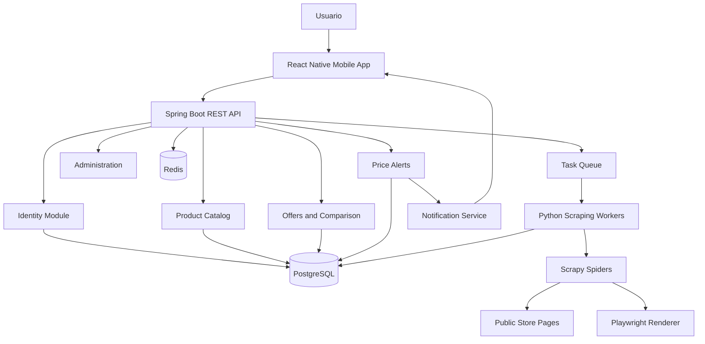
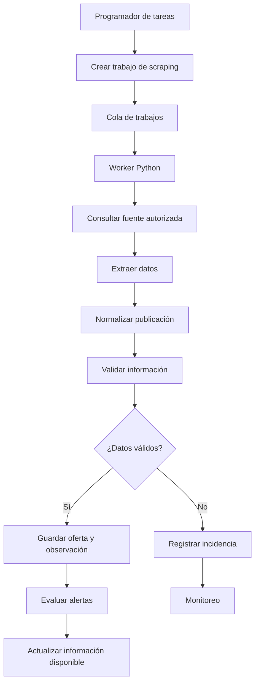
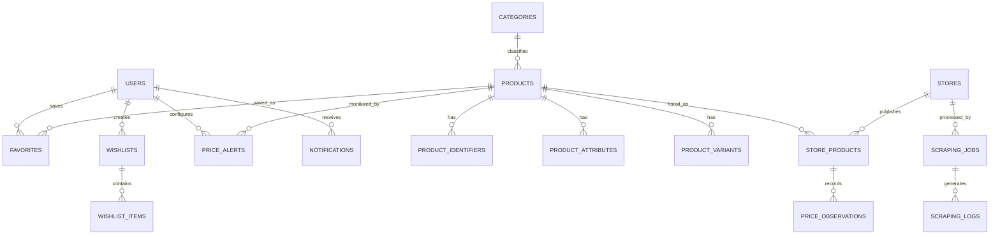

# PRECIO JUSTO

## Documentación funcional y técnica completa

| Campo | Valor |
|---|---|
| **Versión** | 1.0 |
| **Fecha** | 22 de noviembre de 2026 |
| **Mercado inicial** | Perú |
| **Plataformas** | Android e iOS |
| **Tipo de solución** | Aplicación independiente de comparación de precios |
| **Estado** | Definición inicial del producto |

---

## Índice

1. [Visión general del proyecto](#1-visión-general-del-proyecto)
2. [Alcance del producto](#2-alcance-del-producto)
3. [Requerimientos funcionales](#3-requerimientos-funcionales)
4. [Requerimientos no funcionales](#4-requerimientos-no-funcionales)
5. [Arquitectura tecnológica](#5-arquitectura-tecnológica)
6. [Arquitectura general](#6-arquitectura-general)
7. [Diseño del motor de scraping](#7-diseño-del-motor-de-scraping)
8. [Normalización e identificación de productos](#8-normalización-e-identificación-de-productos)
9. [Modelo de datos](#9-modelo-de-datos)
10. [Reglas de negocio](#10-reglas-de-negocio)
11. [API REST](#11-api-rest)
12. [Estructura de proyectos](#12-estructura-de-proyectos)
13. [Seguridad y protección de datos](#13-seguridad-y-protección-de-datos)
14. [Modelo de negocio](#14-modelo-de-negocio)
15. [Plan de desarrollo](#15-plan-de-desarrollo)
16. [Primer sprint: fundación técnica](#16-primer-sprint-fundación-técnica)
17. [Indicadores del proyecto](#17-indicadores-del-proyecto)
18. [Riesgos y mitigaciones](#18-riesgos-y-mitigaciones)
19. [Decisiones técnicas que deben mantenerse](#19-decisiones-técnicas-que-deben-mantenerse)
20. [Visión de evolución](#20-visión-de-evolución)
- [Conclusión](#conclusión)

---

## 1. Visión general del proyecto

### 1.1. Descripción

PRECIO JUSTO es una aplicación móvil que permite a los consumidores buscar productos y comparar sus precios entre distintas tiendas virtuales del mercado peruano.

Su finalidad es ayudar a las personas a tomar mejores decisiones de compra mediante información organizada sobre precios, características, disponibilidad, evolución histórica y enlaces hacia las tiendas donde se comercializan los productos.

La aplicación contará con un motor de extracción automatizada de información mediante web scraping, encargado de consultar las páginas de comercio electrónico, obtener los datos disponibles y procesarlos para presentarlos de manera uniforme.

PRECIO JUSTO será un producto independiente, con sus propios usuarios, base de datos, infraestructura, identidad comercial y modelo de negocio.

### 1.2. Problema que busca resolver

Actualmente, una persona interesada en comprar un producto debe visitar distintas páginas comerciales para conocer sus precios. Esto genera dificultades:

- Inversión de tiempo al consultar diferentes tiendas.
- Dificultad para identificar el mismo producto entre distintas publicaciones.
- Desconocimiento de la evolución histórica de los precios.
- Dificultad para determinar si una oferta representa un ahorro real.
- Falta de alertas cuando un producto alcanza un precio conveniente.
- Información dispersa sobre disponibilidad y costos de envío.

### 1.3. Solución propuesta

Centralizar la información comercial disponible en distintas tiendas mediante una plataforma que permita:

1. Buscar productos.
2. Comparar ofertas.
3. Consultar el historial de precios.
4. Configurar alertas.
5. Guardar productos favoritos.
6. Consultar alternativas similares.
7. Acceder directamente a la tienda para realizar la compra.

### 1.4. Objetivos

**Objetivo general**

Desarrollar una plataforma tecnológica de comparación de precios que facilite la búsqueda de productos y permita identificar opciones de compra convenientes en el mercado peruano.

**Objetivos específicos**

- Implementar una aplicación móvil multiplataforma.
- Construir un backend centralizado.
- Desarrollar un motor de scraping independiente.
- Normalizar productos y ofertas provenientes de distintas tiendas.
- Mantener un historial de precios.
- Implementar alertas configurables.
- Diseñar una arquitectura escalable para incorporar nuevas tiendas y categorías.
- Desarrollar mecanismos de control de calidad y actualización de información.

### 1.5. Principios del producto

- Independencia de las tiendas comerciales.
- Transparencia en la presentación de precios.
- Información con fecha de última verificación.
- Identificación correcta de productos y variantes.
- Protección de la información personal.
- Arquitectura modular.
- Extracción responsable de información.
- No presentar precios antiguos como si fueran actuales.

---

## 2. Alcance del producto

### 2.1. Mercado

El lanzamiento inicial estará dirigido al mercado peruano. La moneda principal será el sol peruano (PEN), aunque el diseño permitirá incorporar otras monedas posteriormente.

El sistema deberá contemplar:

- Precios con IGV cuando corresponda.
- Variaciones de precios por tienda.
- Disponibilidad de productos.
- Costos de envío cuando se encuentren disponibles.
- Ofertas y promociones.
- Diferencias entre vendedores y comercios dentro de marketplaces.

### 2.2. Categorías comerciales

La aplicación tendrá una estructura preparada para manejar múltiples categorías.

| Categoría | Subcategorías de ejemplo |
|---|---|
| Tecnología | Laptops, celulares, monitores, procesadores |
| Computación | SSD, RAM, placas madre, tarjetas gráficas |
| Electrodomésticos | Refrigeradoras, lavadoras, microondas |
| Hogar | Muebles, decoración, iluminación |
| Moda | Ropa, calzado, accesorios |
| Belleza | Cuidado personal, cosméticos |
| Deportes | Equipamiento, ropa deportiva |
| Juguetes | Juegos, juguetes educativos |
| Bebés | Accesorios, productos de cuidado |
| Automotriz | Accesorios, repuestos |
| Ferretería | Herramientas, materiales |
| Libros | Libros físicos y material educativo |

> La inclusión de una categoría no significa que todas sus tiendas estén disponibles desde el primer lanzamiento. Cada categoría se incorporará progresivamente según la viabilidad técnica y las condiciones de acceso a sus fuentes.

### 2.3. Tipos de usuarios

| Tipo | Capacidades |
|---|---|
| **Visitante** | Buscar productos · Consultar comparaciones públicas · Visualizar ofertas |
| **Usuario registrado** | Guardar favoritos · Crear listas de seguimiento · Configurar alertas · Consultar historial de seguimiento · Administrar su perfil |
| **Administrador** | Administrar usuarios · Gestionar tiendas · Gestionar categorías · Supervisar procesos de scraping · Revisar errores · Moderar productos duplicados · Consultar métricas del sistema |
| **Operador de extracción** | Supervisar extractores · Revisar ejecuciones · Gestionar incidencias · Validar información extraída |

---

## 3. Requerimientos funcionales

### RF-01. Gestión de usuarios

El sistema permitirá:

- Registrar usuarios.
- Iniciar y cerrar sesión.
- Recuperar contraseñas.
- Actualizar información de perfil.
- Administrar sesiones y dispositivos.
- Configurar preferencias de notificación.
- Eliminar la cuenta según las condiciones aplicables.

### RF-02. Búsqueda de productos

El usuario podrá buscar productos por:

- Nombre.
- Marca.
- Modelo.
- Código de producto.
- Código EAN/GTIN cuando esté disponible.
- Categoría.
- Palabras clave.

El buscador deberá tolerar errores ortográficos y diferencias menores en los nombres.

> **Ejemplo:** una búsqueda de "Kingston NV3 1TB" debe permitir encontrar publicaciones que contengan variaciones del nombre comercial, sin mezclar automáticamente productos con capacidades diferentes.

### RF-03. Catálogo de productos

Cada producto tendrá:

- Nombre normalizado.
- Marca.
- Modelo.
- Categoría.
- Descripción.
- Imagen de referencia.
- Identificadores comerciales.
- Características técnicas.
- Variantes.
- Estado de publicación.

Los productos deberán diferenciarse de las publicaciones de las tiendas:

- Un **producto** representa el artículo comercial normalizado.
- Una **publicación** representa cómo lo ofrece una tienda.

### RF-04. Comparación de precios

La aplicación presentará las ofertas encontradas para un producto. Información por oferta:

- Nombre de tienda.
- Precio actual detectado.
- Precio anterior, cuando exista y sea verificable.
- Disponibilidad.
- Costo de envío, si se conoce.
- Vendedor.
- Enlace de compra.
- Fecha y hora de última consulta.

El orden predeterminado será de menor a mayor precio, pero se podrán utilizar otros criterios.

> **Regla fundamental:** una oferta con información desactualizada deberá identificarse como tal y no presentarse como precio confirmado.

### RF-05. Historial de precios

El sistema conservará las observaciones históricas de cada oferta. Permitirá visualizar:

- Precio mínimo histórico observado.
- Precio máximo observado.
- Precio promedio del periodo.
- Evolución del precio.
- Fecha de cada observación.
- Variaciones porcentuales.

El historial representará observaciones recopiladas por PRECIO JUSTO, no necesariamente todos los precios que existieron en el mercado.

### RF-06. Alertas de precios

El usuario podrá configurar:

- Producto que desea seguir.
- Precio objetivo.
- Notificaciones habilitadas.
- Estado de la alerta.

Cuando una oferta cumpla la condición, el sistema generará una notificación. Se deberán evitar notificaciones repetidas por una misma condición sin una nueva variación relevante.

### RF-07. Favoritos y listas

El usuario podrá:

- Guardar productos.
- Crear listas personalizadas.
- Eliminar elementos.
- Consultar cambios de precios.
- Acceder a productos seguidos.

### RF-08. Recomendaciones y alternativas

El sistema podrá sugerir productos equivalentes o similares. La comparación deberá considerar:

- Marca.
- Modelo.
- Características.
- Capacidad.
- Dimensiones.
- Versión.
- Compatibilidad.

Las recomendaciones automatizadas deberán identificarse como sugerencias, no como equivalencias confirmadas.

### RF-09. Administración de tiendas

El administrador podrá:

- Registrar tiendas.
- Editar información.
- Activar o desactivar fuentes.
- Configurar frecuencia de extracción.
- Consultar estado del extractor.
- Revisar errores.
- Consultar historial de ejecuciones.

### RF-10. Administración del catálogo

El administrador podrá:

- Crear categorías.
- Modificar categorías.
- Registrar productos.
- Revisar duplicados.
- Relacionar publicaciones con productos.
- Corregir características.
- Desactivar registros incorrectos.

### RF-11. Motor de extracción

El sistema ejecutará procesos automatizados para:

1. Consultar las páginas permitidas.
2. Obtener información comercial.
3. Identificar publicaciones.
4. Extraer precios y disponibilidad.
5. Normalizar datos.
6. Validar resultados.
7. Guardar observaciones.
8. Registrar errores.
9. Actualizar el estado de las ofertas.

### RF-12. Notificaciones

Se contemplan:

- Alertas de precio.
- Cambios relevantes de precio.
- Disponibilidad nuevamente detectada.
- Resumen de productos seguidos.

Canales previstos: notificaciones push y correo electrónico, sujetos a las preferencias y permisos del usuario.

---

## 4. Requerimientos no funcionales

| Código | Requerimiento |
|---|---|
| RNF-01 | Aplicación compatible con Android e iOS |
| RNF-02 | API REST documentada |
| RNF-03 | Autenticación segura |
| RNF-04 | Contraseñas almacenadas mediante hash seguro |
| RNF-05 | Importes monetarios almacenados con precisión decimal |
| RNF-06 | Arquitectura modular |
| RNF-07 | Registro de operaciones importantes |
| RNF-08 | Manejo de errores de extracción |
| RNF-09 | Protección contra consultas abusivas |
| RNF-10 | Respaldo periódico de información |
| RNF-11 | Monitoreo de servicios |
| RNF-12 | Escalabilidad horizontal de trabajadores de scraping |
| RNF-13 | Fecha de verificación visible |
| RNF-14 | Separación de información pública y privada |
| RNF-15 | Pruebas automatizadas |

### Objetivos iniciales de rendimiento

Estos valores serán objetivos de ingeniería que deberán medirse y ajustarse durante las pruebas:

- Respuesta de API de lectura: p95 inferior a 500 ms en condiciones normales.
- Disponibilidad objetivo del backend: 99,5 % mensual en una etapa inicial.
- Paginación para catálogos y ofertas.
- Caché para consultas frecuentes.
- Procesamiento asíncrono para extracción y notificaciones.

No se garantizará una actualización inmediata de precios, porque depende de la frecuencia de consulta permitida y del comportamiento de cada tienda.

---

## 5. Arquitectura tecnológica

### 5.1. Stack seleccionado

| Capa | Tecnología |
|---|---|
| Aplicación móvil | React Native |
| Lenguaje móvil | TypeScript |
| Entorno móvil | Expo |
| Backend | Java + Spring Boot |
| Lenguaje backend | Java |
| Base de datos | PostgreSQL |
| ORM | Spring Data JPA + Hibernate |
| Seguridad | Spring Security + JWT |
| API | REST + OpenAPI |
| Motor scraping | Python |
| Framework scraping | Scrapy |
| Páginas dinámicas | Playwright |
| Procesamiento | Python |
| Cola de trabajos | Redis + Celery |
| Caché | Redis |
| Almacenamiento | S3 compatible |
| Contenedores | Docker |
| Control de versiones | Git |
| CI/CD | GitHub Actions |
| Pruebas backend | JUnit + Mockito |
| Pruebas móviles | Jest + React Native Testing Library |
| Monitoreo | Logs estructurados + métricas |

### 5.2. Justificación

- **React Native + Expo:** permite construir una aplicación móvil para Android e iOS compartiendo gran parte del código.
- **Spring Boot:** será el núcleo de negocio. Gestionará usuarios, productos, ofertas, comparaciones, listas y alertas.
- **Python + Scrapy:** se utilizará para extraer información de las páginas comerciales. Scrapy organiza el proceso mediante spiders, solicitudes, procesamiento de respuestas y pipelines.
- **Playwright:** se empleará cuando una fuente necesite renderizado de JavaScript y el acceso automatizado esté permitido.
- **PostgreSQL:** almacenará la información estructurada y las relaciones entre productos, tiendas, publicaciones y precios.
- **Redis + Celery:** permitirá programar y ejecutar trabajos de extracción sin bloquear las solicitudes de la aplicación móvil.

---

## 6. Arquitectura general

### 6.1. Estilo arquitectónico

Se propone una arquitectura de servicios separados por responsabilidad:

1. Aplicación móvil.
2. Backend de negocio.
3. Servicio de extracción.
4. Trabajadores de procesamiento.
5. Base de datos.
6. Cola de tareas.
7. Servicio de notificaciones.

El backend comenzará como un monolito modular. El motor de scraping estará separado porque tiene necesidades operativas y ciclos de ejecución diferentes.

### 6.2. Diagrama de arquitectura



### 6.3. Flujo de extracción



### 6.4. Separación de responsabilidades

| Componente | Responsabilidad |
|---|---|
| **Aplicación móvil** | No realizará scraping directamente. Solo consumirá la API. |
| **Backend** | No contendrá código específico de extracción de cada tienda. |
| **Servicio de scraping** | No gestionará sesiones de usuarios ni reglas de negocio de la aplicación. Su función será obtener y entregar información estructurada. |
| **Base de datos** | Será la fuente central de información del producto, ofertas e historial. |

---

## 7. Diseño del motor de scraping

### 7.1. Estrategia

Se desarrollará un extractor independiente por tienda.

```text
scraping-engine/
├── app/
│   ├── spiders/
│   │   ├── store_a/
│   │   │   └── products.py
│   │   ├── store_b/
│   │   │   └── products.py
│   │   └── store_c/
│   │       └── products.py
│   │
│   ├── extractors/
│   ├── normalizers/
│   ├── validators/
│   ├── pipelines/
│   ├── schedulers/
│   ├── services/
│   └── config/
│
├── tests/
├── requirements.txt
├── Dockerfile
└── README.md
```

### 7.2. Contrato de datos

Todos los extractores deberán entregar una estructura común:

```json
{
  "store_code": "STORE_A",
  "external_product_id": "ABC-123",
  "title": "Kingston NV3 1TB",
  "brand": "Kingston",
  "model": "NV3",
  "price": 249.90,
  "currency": "PEN",
  "availability": "AVAILABLE",
  "seller": "Tienda A",
  "product_url": "https://example.com/product",
  "image_url": null,
  "checked_at": "2026-11-22T22:00:00Z"
}
```

> El dominio `example.com` es ilustrativo. No representa una tienda integrada ni una oferta real.

### 7.3. Componentes de un extractor

Cada extractor tendrá:

- Identificador de tienda.
- URL de origen.
- Configuración.
- Reglas de extracción.
- Selectores.
- Transformación de datos.
- Validación.
- Gestión de errores.
- Pruebas.
- Registro de última ejecución.

### 7.4. Tipos de extracción

- **Extracción HTML:** para páginas cuyo contenido esté disponible en HTML y pueda consultarse de forma permitida.
- **Extracción con navegador:** para páginas que requieran renderizado de JavaScript. Se utilizará Playwright únicamente cuando corresponda.
- **Extracción mediante estructuras públicas de la página:** cuando la información esté expuesta en estructuras públicas y su uso esté permitido.

> No se utilizarán técnicas para eludir CAPTCHAs, autenticación, controles de acceso, bloqueos u otras medidas de seguridad.

### 7.5. Frecuencia de actualización inicial

| Tipo de producto | Frecuencia propuesta |
|---|---|
| Tecnología popular | 2 a 6 horas |
| Electrodomésticos | 6 a 12 horas |
| Moda | 12 a 24 horas |
| Hogar | 12 a 24 horas |
| Productos de baja demanda | 24 a 48 horas |

Estos intervalos son configurables y estarán subordinados a las condiciones de acceso, límites y políticas de cada fuente.

### 7.6. Reglas de extracción responsable

Antes de activar una tienda:

1. Revisar sus términos de uso.
2. Revisar sus políticas de automatización.
3. Consultar `robots.txt`.
4. Determinar qué páginas pueden consultarse.
5. Respetar límites de frecuencia.
6. No acceder a información privada.
7. No recopilar datos personales innecesarios.
8. No evadir mecanismos de seguridad.
9. Registrar la autorización o evaluación correspondiente.
10. Desactivar el extractor cuando cambien las condiciones de acceso.

> La presencia de información pública o de una instrucción en `robots.txt` no debe interpretarse por sí sola como una autorización legal ilimitada para cualquier uso.

---

## 8. Normalización e identificación de productos

Este será uno de los componentes más importantes del proyecto.

### 8.1. Problema

Dos tiendas pueden publicar el mismo producto con nombres distintos. Ejemplo:

- Kingston SSD NV3 1TB.
- Disco sólido Kingston NV3 de 1000 GB.
- SSD Kingston 1TB PCIe 4.0 NV3.

El sistema deberá identificar si realmente corresponden al mismo producto.

### 8.2. Niveles de coincidencia

| Nivel | Tipo | Criterio |
|---|---|---|
| 1 | Identificación exacta | Coincidencia por EAN, GTIN u otro identificador confiable |
| 2 | Coincidencia por modelo | Marca, modelo, capacidad y características principales |
| 3 | Coincidencia por similitud | Comparación de nombres, atributos y características |
| 4 | Revisión manual | Cuando exista incertidumbre, la publicación quedará pendiente de validación |

### 8.3. Reglas

No mezclar automáticamente:

- Productos de diferente capacidad.
- Diferentes generaciones.
- Versiones distintas.
- Colores cuando sean variantes relevantes.
- Productos nuevos y reacondicionados.
- Productos individuales y paquetes.
- Diferentes configuraciones técnicas.

La IA podrá asistir en la normalización, pero no será la autoridad definitiva para fusionar productos.

### 8.4. Puntuación de coincidencia

Se propone una puntuación de 0 a 100 basada en:

| Criterio | Puntos |
|---|---|
| Marca | 20 |
| Modelo | 30 |
| Características | 30 |
| Capacidad o variante | 15 |
| Identificadores | 5 adicionales, o como evidencia de validación prioritaria |

Umbrales iniciales:

| Puntuación | Interpretación |
|---|---|
| 95 a 100 | Coincidencia de alta confianza |
| 80 a 94 | Coincidencia probable, requiere reglas adicionales |
| Menor a 80 | No fusionar automáticamente |

Estos umbrales se ajustarán con datos reales y pruebas de falsos positivos.

---

## 9. Modelo de datos

### 9.1. Entidades principales

| Entidad | Responsabilidad |
|---|---|
| `users` | Usuarios registrados |
| `roles` | Roles del sistema |
| `user_roles` | Relación usuarios y roles |
| `stores` | Tiendas |
| `categories` | Categorías |
| `products` | Catálogo normalizado |
| `product_identifiers` | Códigos comerciales |
| `product_attributes` | Características |
| `product_variants` | Variantes |
| `store_products` | Publicaciones de tiendas |
| `price_observations` | Observaciones históricas |
| `scraping_jobs` | Trabajos de extracción |
| `scraping_logs` | Resultados y errores |
| `favorites` | Productos favoritos |
| `wishlists` | Listas del usuario |
| `wishlist_items` | Productos de cada lista |
| `price_alerts` | Alertas |
| `notifications` | Notificaciones |
| `devices` | Dispositivos registrados |
| `audit_logs` | Auditoría |

### 9.2. Relaciones principales



### 9.3. Definición de tablas

#### `users`

| Columna | Tipo | Notas |
|---|---|---|
| id | UUID | PK |
| email | VARCHAR(255) | UNIQUE |
| password_hash | VARCHAR(255) | |
| full_name | VARCHAR(150) | |
| status | VARCHAR(30) | |
| created_at | TIMESTAMP | |
| updated_at | TIMESTAMP | |

#### `roles`

| Columna | Tipo | Notas |
|---|---|---|
| id | UUID | PK |
| name | VARCHAR(50) | UNIQUE |
| description | VARCHAR(255) | |

#### `user_roles`

| Columna | Tipo | Notas |
|---|---|---|
| user_id | UUID | FK |
| role_id | UUID | FK |

PK compuesta: `user_id + role_id`.

#### `stores`

| Columna | Tipo | Notas |
|---|---|---|
| id | UUID | PK |
| name | VARCHAR(150) | |
| code | VARCHAR(50) | UNIQUE |
| base_url | TEXT | |
| country_code | CHAR(2) | |
| status | VARCHAR(30) | |
| scraping_enabled | BOOLEAN | |
| scraping_interval_minutes | INTEGER | |
| terms_reviewed_at | TIMESTAMP | |
| created_at | TIMESTAMP | |
| updated_at | TIMESTAMP | |

#### `categories`

| Columna | Tipo | Notas |
|---|---|---|
| id | UUID | PK |
| parent_id | UUID | FK nullable |
| name | VARCHAR(120) | |
| slug | VARCHAR(150) | UNIQUE |
| description | TEXT | |
| status | VARCHAR(30) | |

#### `products`

| Columna | Tipo | Notas |
|---|---|---|
| id | UUID | PK |
| category_id | UUID | FK |
| brand | VARCHAR(120) | |
| model | VARCHAR(180) | |
| normalized_name | VARCHAR(300) | |
| description | TEXT | |
| image_url | TEXT | |
| condition_type | VARCHAR(30) | |
| status | VARCHAR(30) | |
| created_at | TIMESTAMP | |
| updated_at | TIMESTAMP | |

#### `product_identifiers`

| Columna | Tipo | Notas |
|---|---|---|
| id | UUID | PK |
| product_id | UUID | FK |
| identifier_type | VARCHAR(30) | |
| identifier_value | VARCHAR(150) | |

UNIQUE: `identifier_type + identifier_value`.

#### `product_attributes`

| Columna | Tipo | Notas |
|---|---|---|
| id | UUID | PK |
| product_id | UUID | FK |
| attribute_name | VARCHAR(100) | |
| attribute_value | VARCHAR(255) | |
| normalized_value | VARCHAR(255) | |

#### `product_variants`

| Columna | Tipo | Notas |
|---|---|---|
| id | UUID | PK |
| product_id | UUID | FK |
| variant_name | VARCHAR(150) | |
| variant_attributes | JSONB | |
| status | VARCHAR(30) | |

#### `store_products`

| Columna | Tipo | Notas |
|---|---|---|
| id | UUID | PK |
| store_id | UUID | FK |
| product_id | UUID | FK nullable hasta validación |
| external_product_id | VARCHAR(180) | |
| title | VARCHAR(500) | |
| product_url | TEXT | |
| image_url | TEXT | |
| seller_name | VARCHAR(180) | |
| condition_type | VARCHAR(30) | |
| match_status | VARCHAR(30) | |
| match_score | DECIMAL(5,2) | |
| current_price | DECIMAL(14,2) | |
| currency_code | CHAR(3) | |
| availability | VARCHAR(30) | |
| last_checked_at | TIMESTAMP | |
| created_at | TIMESTAMP | |
| updated_at | TIMESTAMP | |

Restricción recomendada: `UNIQUE(store_id, external_product_id)`.

#### `price_observations`

| Columna | Tipo | Notas |
|---|---|---|
| id | UUID | PK |
| store_product_id | UUID | FK |
| price | DECIMAL(14,2) | |
| currency_code | CHAR(3) | |
| previous_price | DECIMAL(14,2) | nullable |
| availability | VARCHAR(30) | |
| shipping_cost | DECIMAL(14,2) | nullable |
| seller_name | VARCHAR(180) | |
| observed_at | TIMESTAMP | |
| source_status | VARCHAR(30) | |

#### `scraping_jobs`

| Columna | Tipo | Notas |
|---|---|---|
| id | UUID | PK |
| store_id | UUID | FK |
| job_type | VARCHAR(40) | |
| status | VARCHAR(30) | |
| started_at | TIMESTAMP | |
| finished_at | TIMESTAMP | |
| products_found | INTEGER | |
| products_validated | INTEGER | |
| products_failed | INTEGER | |
| error_summary | TEXT | |

#### `scraping_logs`

| Columna | Tipo | Notas |
|---|---|---|
| id | UUID | PK |
| job_id | UUID | FK |
| severity | VARCHAR(20) | |
| message | TEXT | |
| context | JSONB | |
| created_at | TIMESTAMP | |

#### `favorites`

| Columna | Tipo | Notas |
|---|---|---|
| id | UUID | PK |
| user_id | UUID | FK |
| product_id | UUID | FK |
| created_at | TIMESTAMP | |

UNIQUE: `(user_id, product_id)`.

#### `wishlists`

| Columna | Tipo | Notas |
|---|---|---|
| id | UUID | PK |
| user_id | UUID | FK |
| name | VARCHAR(120) | |
| created_at | TIMESTAMP | |

#### `wishlist_items`

| Columna | Tipo | Notas |
|---|---|---|
| id | UUID | PK |
| wishlist_id | UUID | FK |
| product_id | UUID | FK |
| created_at | TIMESTAMP | |

#### `price_alerts`

| Columna | Tipo | Notas |
|---|---|---|
| id | UUID | PK |
| user_id | UUID | FK |
| product_id | UUID | FK |
| target_price | DECIMAL(14,2) | |
| currency_code | CHAR(3) | |
| condition_type | VARCHAR(30) | |
| status | VARCHAR(30) | |
| last_triggered_at | TIMESTAMP | |
| created_at | TIMESTAMP | |

#### `notifications`

| Columna | Tipo | Notas |
|---|---|---|
| id | UUID | PK |
| user_id | UUID | FK |
| type | VARCHAR(40) | |
| title | VARCHAR(180) | |
| message | TEXT | |
| payload | JSONB | |
| read_at | TIMESTAMP | |
| created_at | TIMESTAMP | |

#### `devices`

| Columna | Tipo | Notas |
|---|---|---|
| id | UUID | PK |
| user_id | UUID | FK |
| platform | VARCHAR(20) | |
| push_token | TEXT | |
| status | VARCHAR(30) | |
| last_seen_at | TIMESTAMP | |

#### `audit_logs`

| Columna | Tipo | Notas |
|---|---|---|
| id | UUID | PK |
| user_id | UUID | FK nullable |
| action | VARCHAR(100) | |
| entity_type | VARCHAR(100) | |
| entity_id | UUID | |
| details | JSONB | |
| created_at | TIMESTAMP | |

### 9.4. Índices importantes

- `products.normalized_name`
- `products.category_id`
- `store_products.product_id`
- `store_products.store_id`
- `store_products.current_price`
- `store_products.last_checked_at`
- `price_observations.store_product_id + observed_at`
- `price_alerts.user_id + status`
- `product_identifiers.identifier_type + identifier_value`

Se deberán evaluar índices compuestos adicionales con consultas reales.

### 9.5. Reglas de almacenamiento

- Usar UUID como identificador principal.
- Utilizar DECIMAL para dinero, nunca FLOAT.
- Conservar la moneda original de cada observación.
- Guardar fechas en UTC y convertirlas a hora local al mostrarlas.
- No sobrescribir el historial de precios.
- Mantener la publicación separada del producto normalizado.
- Evitar duplicados mediante restricciones únicas.
- Utilizar borrado lógico para registros comerciales cuando sea necesario.
- Aplicar retención y particionamiento al historial cuando el volumen lo justifique.

---

## 10. Reglas de negocio

| Código | Regla | Descripción |
|---|---|---|
| RN-01 | Precio vigente | Una oferta solo podrá mostrarse como verificada cuando su última consulta se encuentre dentro de un periodo de vigencia configurable. |
| RN-02 | Precio más bajo | El precio más bajo se calculará considerando ofertas comparables y válidas. |
| RN-03 | Costo total | Cuando se disponga de información suficiente: **costo total = precio del producto + costo de envío**. No se sumará un envío desconocido como si fuera cero. |
| RN-04 | Moneda | Las comparaciones directas deberán utilizar la misma moneda. Si se incorpora conversión, deberá mostrarse el tipo de cambio y la fecha de referencia. |
| RN-05 | Disponibilidad | Valores permitidos: `AVAILABLE`, `OUT_OF_STOCK`, `PREORDER`, `UNKNOWN`. |
| RN-06 | Productos duplicados | No fusionar publicaciones automáticamente cuando la coincidencia no alcance el nivel de confianza establecido. |
| RN-07 | Historial | Cada observación válida generará un registro histórico, incluso si el precio no cambia, cuando sea necesario medir la continuidad de la verificación. Para reducir volumen, se podrá aplicar una política de conservación de observaciones repetidas sin perder la trazabilidad necesaria. |
| RN-08 | Alertas | Una alerta se activará únicamente cuando exista una observación válida que cumpla su condición. |
| RN-09 | Información desactualizada | Las ofertas que no puedan actualizarse se marcarán como desactualizadas después del periodo de vigencia configurado. |
| RN-10 | Publicaciones comerciales | El enlace deberá dirigir al usuario a la publicación correspondiente de la tienda. PRECIO JUSTO no procesará pagos ni será responsable de la transacción comercial de terceros en su primera versión. |

---

## 11. API REST

Prefijo general: `/api/v1`

### 11.1. Autenticación

| Método | Endpoint | Función |
|---|---|---|
| POST | `/auth/register` | Registrar usuario |
| POST | `/auth/login` | Iniciar sesión |
| POST | `/auth/refresh` | Renovar token |
| POST | `/auth/logout` | Cerrar sesión |
| POST | `/auth/forgot-password` | Recuperar contraseña |

### 11.2. Productos

| Método | Endpoint | Función |
|---|---|---|
| GET | `/products` | Listar productos |
| GET | `/products/{id}` | Detalle |
| GET | `/products/search?q=` | Buscar |
| GET | `/products/{id}/offers` | Comparar ofertas |
| GET | `/products/{id}/history` | Historial |

### 11.3. Categorías

| Método | Endpoint | Función |
|---|---|---|
| GET | `/categories` | Listar categorías |
| GET | `/categories/{id}` | Detalle |
| GET | `/categories/{id}/products` | Productos por categoría |

### 11.4. Favoritos y listas

| Método | Endpoint | Función |
|---|---|---|
| GET | `/favorites` | Consultar favoritos |
| POST | `/favorites/{productId}` | Agregar favorito |
| DELETE | `/favorites/{productId}` | Quitar favorito |
| GET | `/wishlists` | Consultar listas |
| POST | `/wishlists` | Crear lista |
| POST | `/wishlists/{id}/items` | Agregar producto |

### 11.5. Alertas

| Método | Endpoint | Función |
|---|---|---|
| GET | `/price-alerts` | Consultar alertas |
| POST | `/price-alerts` | Crear alerta |
| PUT | `/price-alerts/{id}` | Modificar alerta |
| DELETE | `/price-alerts/{id}` | Eliminar alerta |

### 11.6. Administración

| Método | Endpoint | Función |
|---|---|---|
| GET | `/admin/stores` | Listar tiendas |
| POST | `/admin/stores` | Crear tienda |
| PUT | `/admin/stores/{id}` | Modificar tienda |
| GET | `/admin/scraping/jobs` | Consultar trabajos |
| POST | `/admin/scraping/jobs` | Solicitar extracción |
| GET | `/admin/scraping/logs` | Consultar registros |
| GET | `/admin/products/pending` | Productos pendientes de revisión |

El servicio de scraping tendrá autenticación de servicio a servicio. No se expondrán directamente los trabajadores a Internet.

---

## 12. Estructura de proyectos

Se recomienda mantener un repositorio principal con separación por servicios.

```text
precio-justo/
│
├── mobile-app/
│   ├── src/
│   │   ├── components/
│   │   ├── screens/
│   │   ├── navigation/
│   │   ├── services/
│   │   ├── hooks/
│   │   ├── store/
│   │   ├── types/
│   │   └── utils/
│   ├── assets/
│   └── package.json
│
├── backend/
│   ├── src/main/java/com/preciojusto/
│   │   ├── identity/
│   │   ├── users/
│   │   ├── products/
│   │   ├── categories/
│   │   ├── stores/
│   │   ├── offers/
│   │   ├── pricehistory/
│   │   ├── favorites/
│   │   ├── wishlists/
│   │   ├── alerts/
│   │   ├── notifications/
│   │   ├── scraping/
│   │   ├── administration/
│   │   └── shared/
│   └── pom.xml
│
├── scraping-engine/
│   ├── app/
│   │   ├── spiders/
│   │   ├── extractors/
│   │   ├── normalizers/
│   │   ├── validators/
│   │   ├── pipelines/
│   │   └── workers/
│   ├── tests/
│   └── requirements.txt
│
├── infrastructure/
│   ├── docker/
│   ├── postgres/
│   ├── redis/
│   └── monitoring/
│
├── docs/
│   ├── architecture/
│   ├── database/
│   ├── api/
│   ├── requirements/
│   └── decisions/
│
├── docker-compose.yml
└── README.md
```

---

## 13. Seguridad y protección de datos

### 13.1. Seguridad de aplicación

- Autenticación mediante JWT.
- Refresh tokens con rotación y revocación.
- Contraseñas con BCrypt o Argon2.
- Validación de entradas.
- Control de acceso por roles.
- Rate limiting.
- CORS restringido.
- Protección de secretos mediante variables de entorno.
- HTTPS.
- Auditoría de acciones administrativas.

### 13.2. Protección de usuarios

El sistema deberá recopilar únicamente los datos personales necesarios para prestar el servicio. Se deberán establecer:

- Política de privacidad.
- Condiciones de uso.
- Consentimiento cuando corresponda.
- Procedimientos de atención de derechos de los titulares.
- Políticas de retención y eliminación.
- Controles de acceso.
- Gestión de incidentes.

En Perú se debe considerar la **Ley N.° 29733** y su Reglamento aprobado por el **Decreto Supremo N.° 016-2024-JUS**, vigente desde el 31 de marzo de 2025.

### 13.3. Seguridad del scraping

- No guardar credenciales de clientes de tiendas.
- No acceder a áreas privadas.
- No eludir mecanismos de protección.
- No utilizar información personal de compradores.
- Limitar frecuencia de solicitudes.
- Mantener trazabilidad de las fuentes.
- Detener extractores ante cambios de restricciones o condiciones de acceso.

La viabilidad jurídica y contractual deberá evaluarse individualmente para cada tienda antes de su incorporación comercial.

---

## 14. Modelo de negocio

### 14.1. Freemium

| Versión gratuita | Versión Premium |
|---|---|
| Búsquedas | Mayor cantidad de alertas |
| Comparación de ofertas | Seguimiento ampliado |
| Historial básico | Historial avanzado |
| Favoritos limitados | Comparaciones personalizadas |
| Alertas básicas | Notificaciones adicionales |
| | Herramientas de análisis de precios |

### 14.2. Ingresos adicionales

- Programas de afiliación.
- Comisiones por compras referidas.
- Publicidad patrocinada.
- Alianzas comerciales.
- Servicios de análisis de precios para comercios.

> Las ofertas patrocinadas deberán estar claramente identificadas y no alterar de manera encubierta el ordenamiento por precio.

---

## 15. Plan de desarrollo

Se propone una planificación de 10 sprints. La duración inicial de cada sprint será de dos semanas y podrá ajustarse según el equipo y los resultados.

| Sprint | Objetivo | Entregable |
|---|---|---|
| 1 | Fundación técnica | Repositorios, Docker, API y base de datos |
| 2 | Usuarios y seguridad | Registro y autenticación |
| 3 | Catálogo | Productos, categorías y búsqueda |
| 4 | Motor scraping | Primeros extractores y procesamiento |
| 5 | Comparación | Ofertas y precios |
| 6 | Historial | Observaciones y gráficos |
| 7 | Seguimiento | Favoritos, listas y alertas |
| 8 | Aplicación móvil | Experiencia móvil completa |
| 9 | Administración | Panel de tiendas y monitoreo |
| 10 | Calidad y lanzamiento | Pruebas, seguridad y despliegue |

---

## 16. Primer sprint: fundación técnica

### 16.1. Objetivo

Establecer la estructura inicial de PRECIO JUSTO, preparar el entorno de desarrollo y conseguir comunicación funcional entre la aplicación móvil, el backend y PostgreSQL. También se preparará la estructura independiente del motor de scraping.

**Duración propuesta:** 2 semanas.

### 16.2. Historias de usuario

#### US-001. Estructura del proyecto

*Como desarrollador, quiero contar con una estructura organizada de repositorios y servicios para trabajar de manera independiente en cada componente.*

Criterios de aceptación:

- [ ] Existe el repositorio principal.
- [ ] Se encuentran separados `mobile-app`, `backend` y `scraping-engine`.
- [ ] Existe documentación inicial.
- [ ] Se puede levantar el entorno de desarrollo.

#### US-002. Configuración de base de datos

*Como desarrollador, quiero conectar Spring Boot con PostgreSQL para persistir información.*

Criterios:

- [ ] PostgreSQL funciona en Docker.
- [ ] Spring Boot conecta correctamente.
- [ ] Se ejecutan migraciones.
- [ ] Existe configuración de desarrollo.
- [ ] Las credenciales no están expuestas en el repositorio.

Se recomienda utilizar **Flyway** para controlar las migraciones.

#### US-003. API inicial

*Como desarrollador, quiero disponer de una API REST funcional para comprobar el backend.*

Criterios:

- [ ] Spring Boot inicia correctamente.
- [ ] Existe endpoint de salud.
- [ ] OpenAPI está configurado.
- [ ] Existe manejo centralizado de excepciones.
- [ ] Se pueden ejecutar pruebas automatizadas.

#### US-004. Servicio de scraping inicial

*Como desarrollador, quiero contar con la estructura inicial del motor Python para incorporar extractores posteriormente.*

Criterios:

- [ ] Proyecto Python organizado.
- [ ] Scrapy instalado.
- [ ] Configuración de logging.
- [ ] Contrato de datos definido.
- [ ] Pruebas unitarias iniciales.
- [ ] Comunicación interna preparada con el backend o cola de trabajos.

#### US-005. Aplicación móvil inicial

*Como usuario, quiero disponer de una aplicación móvil que pueda iniciar y conectarse al backend.*

Criterios:

- [ ] Proyecto React Native creado.
- [ ] TypeScript configurado.
- [ ] Navegación inicial.
- [ ] Pantalla principal.
- [ ] Servicio HTTP.
- [ ] Conexión al endpoint de salud.

### 16.3. Tareas técnicas

**Backend**

- [ ] Crear proyecto Spring Boot.
- [ ] Configurar Java y Maven.
- [ ] Agregar Spring Web.
- [ ] Agregar Spring Data JPA.
- [ ] Agregar PostgreSQL Driver.
- [ ] Configurar Flyway.
- [ ] Configurar Spring Security para etapas posteriores.
- [ ] Crear estructura modular.
- [ ] Configurar OpenAPI.
- [ ] Implementar `/api/v1/health`.

**Base de datos**

- [ ] Crear base `precio_justo`.
- [ ] Configurar usuario de aplicación.
- [ ] Crear esquema inicial.
- [ ] Configurar persistencia.
- [ ] Preparar migraciones.

**Scraping**

- [ ] Crear entorno Python.
- [ ] Instalar Scrapy.
- [ ] Crear estructura de spiders.
- [ ] Crear modelo de producto extraído.
- [ ] Crear validadores.
- [ ] Crear pipeline.
- [ ] Implementar una prueba con HTML local de ejemplo.

> No se iniciará extracción masiva de tiendas reales durante esta etapa.

**Mobile**

- [ ] Crear proyecto Expo.
- [ ] Configurar TypeScript.
- [ ] Configurar navegación.
- [ ] Crear pantalla de inicio.
- [ ] Crear cliente HTTP.
- [ ] Conectar con backend.

**Infraestructura**

- [ ] Crear Docker Compose.
- [ ] Configurar PostgreSQL.
- [ ] Configurar Redis.
- [ ] Preparar variables de entorno.
- [ ] Crear documentación de instalación.

### 16.4. Entregables del sprint

1. Repositorio inicial.
2. Backend operativo.
3. PostgreSQL conectado.
4. Migraciones configuradas.
5. Motor Python estructurado.
6. Aplicación móvil inicial.
7. Docker Compose.
8. Documentación técnica.
9. Pruebas iniciales.
10. Diagrama de arquitectura actualizado.

### 16.5. Definición de terminado

El sprint estará terminado cuando:

- [ ] Los servicios puedan iniciarse desde el entorno documentado.
- [ ] La API responda correctamente.
- [ ] PostgreSQL persista información.
- [ ] La aplicación móvil pueda consultar la API.
- [ ] El motor de scraping ejecute una prueba controlada.
- [ ] Las pruebas automatizadas pasen.
- [ ] No existan secretos en el repositorio.
- [ ] La documentación permita que otro desarrollador levante el proyecto.

---

## 17. Indicadores del proyecto

### Indicadores técnicos

- Cantidad de tiendas habilitadas.
- Porcentaje de ejecuciones exitosas.
- Porcentaje de registros válidos.
- Cantidad de productos identificados correctamente.
- Cantidad de publicaciones pendientes de revisión.
- Tiempo promedio de extracción.
- Tiempo desde última verificación.
- Tasa de errores por tienda.

### Indicadores de producto

- Usuarios registrados.
- Usuarios activos.
- Búsquedas realizadas.
- Productos consultados.
- Productos favoritos.
- Alertas creadas.
- Clics hacia tiendas.
- Ahorro potencial observado.

> El ahorro potencial deberá calcularse únicamente sobre ofertas comparables y verificadas, sin afirmar que el usuario realizó una compra o consiguió un ahorro real si no se tiene esa confirmación.

---

## 18. Riesgos y mitigaciones

| Riesgo | Mitigación |
|---|---|
| Cambios en páginas de tiendas | Pruebas y mantenimiento de extractores |
| Bloqueo de consultas | Respetar políticas y límites; suspender el extractor |
| Productos duplicados | Normalización y revisión |
| Precios incorrectos | Validación y trazabilidad |
| Ofertas desactualizadas | Fecha de verificación y vencimiento |
| Gran volumen de datos | Índices, particiones y políticas de retención |
| Variaciones de envío | Mostrar información incompleta como desconocida |
| Costos de infraestructura | Extracción programada y caché |
| Riesgos legales | Evaluación individual de cada fuente |

---

## 19. Decisiones técnicas que deben mantenerse

1. PRECIO JUSTO es independiente de FINANCIO.
2. El mercado inicial es Perú.
3. La cobertura funcional contempla múltiples categorías.
4. La extracción de información se realizará principalmente mediante scraping.
5. React Native será la tecnología móvil.
6. Spring Boot será el backend principal.
7. PostgreSQL será la base de datos principal.
8. Python será el motor de scraping.
9. El backend y el motor de scraping estarán separados.
10. El sistema iniciará con una arquitectura modular, sin microservicios innecesarios.
11. No se fusionarán productos sin evidencia suficiente.
12. Las observaciones de precios conservarán su historial.
13. La aplicación no realizará compras directamente en su primera versión.
14. La incorporación de cada tienda estará condicionada a su evaluación técnica, contractual y legal.

---

## 20. Visión de evolución

Una vez validado el producto inicial, se podrán incorporar:

- Búsqueda por fotografía.
- Escaneo de códigos de barras.
- Comparación inteligente con IA.
- Recomendaciones de alternativas.
- Análisis de tendencias.
- Predicción experimental de precios.
- Comparación de costos de envío.
- Panel de análisis comercial.
- Expansión a otros mercados latinoamericanos.

Estas capacidades no forman parte del primer sprint y deberán desarrollarse cuando exista suficiente información confiable.

---

## Conclusión

PRECIO JUSTO busca convertirse en una plataforma de referencia para comparar precios en el mercado peruano.

Su principal ventaja competitiva no será únicamente extraer precios, sino identificar correctamente los productos, mantener información histórica confiable y presentar comparaciones útiles para el consumidor.

La prioridad inicial será construir una base técnica sólida y demostrar que el sistema puede extraer, normalizar y comparar correctamente información de distintas fuentes antes de ampliar su cobertura comercial.
